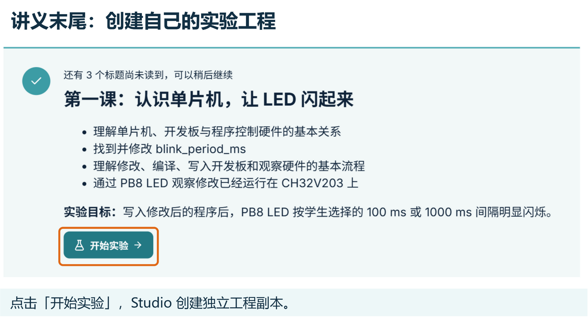
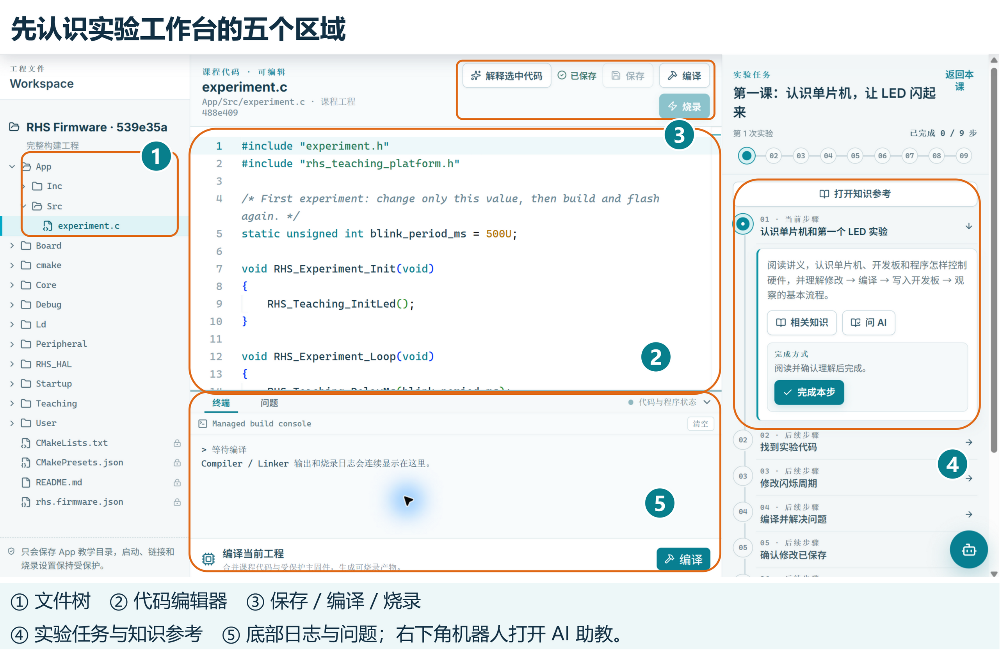
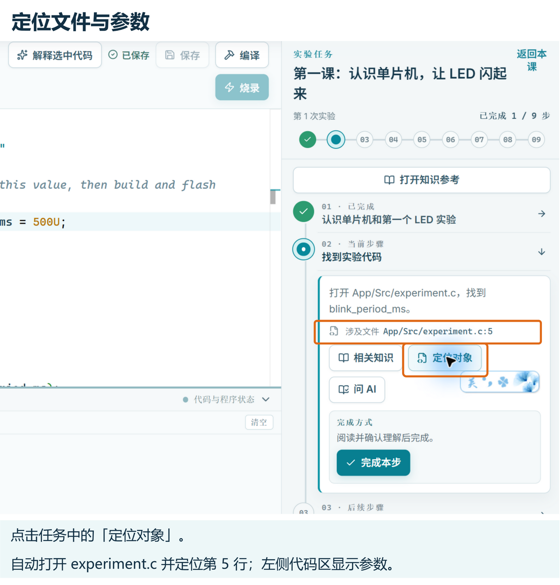
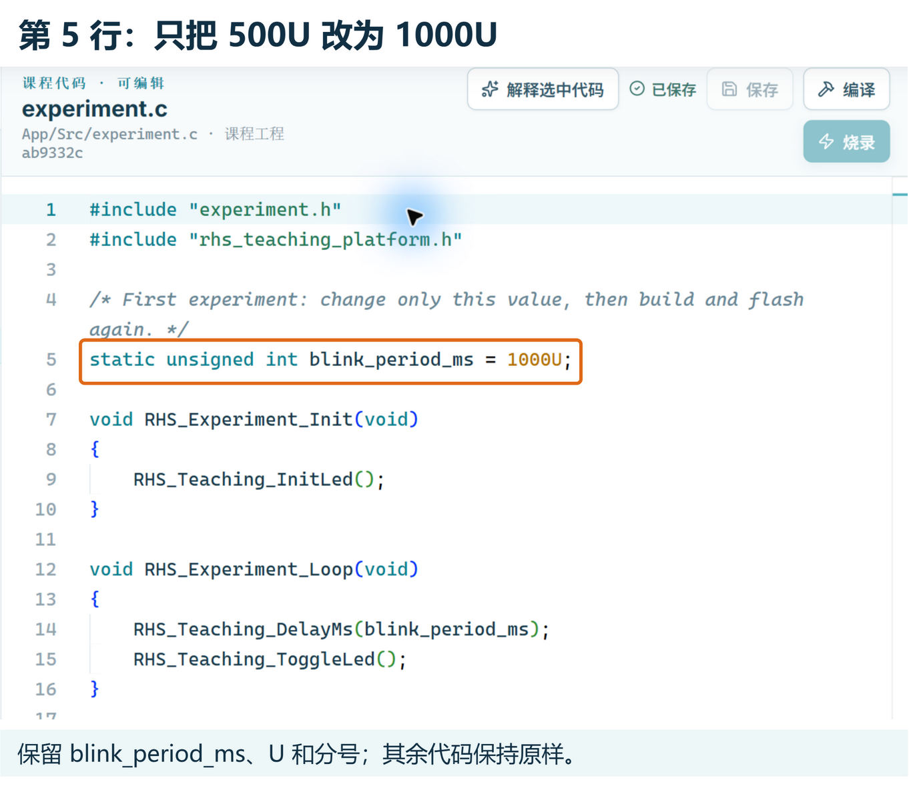
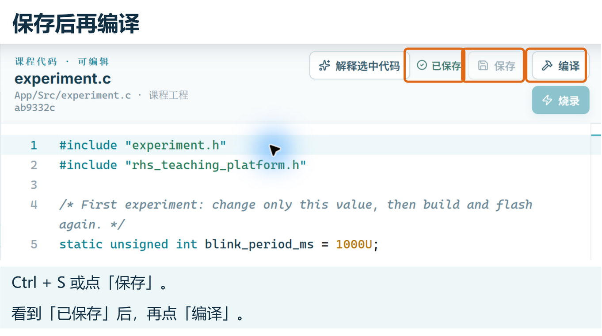
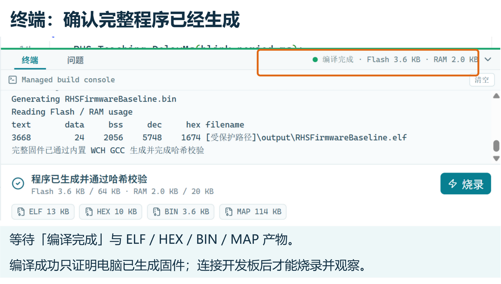
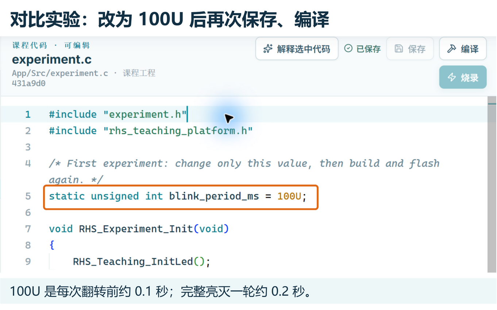

## 第一课：认识单片机，让 LED 闪起来 {#introduction}

欢迎来到单片机开发世界！本课程专为零基础初学者设计，无需提前掌握复杂的电子电路或芯片内部微架构。今天我们只聚焦三个最核心的问题：

1. **单片机是什么？** 它与我们日常用的电脑、手里的电路板有什么区别？
2. **程序如何跨越虚拟与现实？** 一行 C 语言代码是怎样让现实中的灯亮起来的？
3. **单片机开发的实际流程是什么？** 怎样在软件中经历“修改代码 → 编译 → 烧录 → 观察”的完整过程？

在本课结尾，你将亲自动手修改一个参数，把程序真正写入开发板，亲眼见证板载 LED 按照你设定的节奏改变闪烁速度。

---

### 1. 认识单片机：装在芯片里的微型计算机 {#what-is-mcu}

想一想身边的日常设备：电饭煲如何自动定时和保温、无人机如何保持平稳飞行、机器马如何协调四肢行走？这些设备虽然形态各异，但背后都有一颗负责运算并实时控制硬件的“微型大脑”——**单片机**。

单片机在行业中通常被称为 **MCU（Microcontroller Unit，微控制器）**。与我们平时用的台式电脑或笔记本不同：
- **普通电脑**：追求通用算力，用来浏览网页、处理文档、运行大型软件；
- **单片机**：体积微小、功耗极低、通电瞬间就能工作，专门负责**精确测量传感器信号并控制外部电子设备**。

它把计算机的核心部件（负责运算的 CPU、存放代码和数据的存储区、与外界通信的引脚控制电路）全部集成在了一颗指甲盖大小的芯片里。

:::concept[微控制器（MCU）]
单片机（MCU）是将计算机的核心部件全部集成在一颗芯片上的微型计算机，专用于自动化控制与电子设备操作。在嵌入式开发中，单片机与 MCU 通常指同一个概念。
:::

---

### 2. 单片机与现实世界：输入与输出模型 {#input-output}

单片机本身只是一颗芯片。四周伸出的一排排金属小细腿叫作**引脚（Pin）**。单片机通过这些引脚与外部世界连结，构成了经典的“输入—处理—输出”模型：

| 类别 | 角色定位 | 典型器件 | 在机器马系统中的分工 |
| :--- | :--- | :--- | :--- |
| **输入（Input）** | 收集环境信号，告诉单片机“发生了什么” | 按键、光电传感器、红外测距、摄像头 | 感知地面黑线、检测前方是否有障碍物 |
| **核心处理（MCU）** | 运行程序代码，根据输入做出计算与决策 | **CH32V203C8T6**（开发板中央的主控芯片） | 分析环境信息、协调四肢动作、控制机身保持平衡 |
| **输出（Output）** | 接收单片机电平指令，转化为物理动作 | LED 指示灯、蜂鸣器、舵机、驱动电机 | 驱动马腿摆动、发出蜂鸣报警、闪烁状态灯 |

无论是今天控制一颗小小的 LED，还是以后控制整只机器马奔跑，整个系统的骨架都是相通的：  
`[外界传感器信号输入] → [单片机运行程序做出决策] → [控制引脚输出动作（驱动马腿或点亮 LED）]`。

---

### 3. 概念辨析：单片机芯片 vs 教学开发板 {#chip-and-board}

初学者最容易将“整块电路板”误认为单片机。请明确区分：

- **单片机（MCU）**：特指电路板中央那颗负责执行指令的黑色方形芯片（本平台使用 **CH32V203C8T6**）。
- **教学开发板（Board）**：是以单片机为核心，在其外围焊接了电源芯片、USB 调试器（WCH-Link 模块）、按键、LED 和排针的整套学习底板。

开发板为芯片铺好了供电和连接线路，免去了我们自己焊接电路的麻烦，让我们能够插上 USB 线就直接开始编程实验。

:::note[为什么从板载 LED 开始？]
LED（发光二极管）是最直观的硬件“探针”。单片机通过内部程序控制引脚接通电压，LED 就点亮；断开电压，LED 就熄灭。看到 LED 按你的节奏闪烁，就证明你的代码已经真正接管了现实中的硬件！
:::

---

## 认识 Studio：从课程进入实验工作台 {#studio-tour}

先在真实界面里找到入口，再动手改代码。下面的截图来自最大化的 **CH32V203 沁恒版** Studio；橙色图框、编号和图外说明是教学标注。版本号和实验进度会随你的学习记录变化，操作时认准按钮文字。图片可以点击查看原图。

1. 在首页的 **课程学习** 卡片中点击 **【进入课程】**。
2. 在课程中心左侧选择第一课，点击右下角 **【开始学习】**。
3. 在讲义页左侧点击章节标题定位内容，中间阅读讲义。
4. 阅读后滚动到讲义末尾，点击 **【开始实验】**。Studio 会创建一份属于本次实验的独立工程副本。




### 先认识工作台的常用区域 {#workbench-tour}



| 图中区域 | 在这里做什么 | 本课操作 |
| :--- | :--- | :--- |
| **① 工程文件树** | 展开文件夹、打开文件 | 展开 `App → Src`，点击 `experiment.c` |
| **② 中央代码编辑器** | 阅读和修改当前文件 | 找到第 5 行的 `blink_period_ms` |
| **③ 保存 / 编译 / 烧录** | 保存源文件、生成固件、写入开发板 | 每次改动后按这个顺序操作 |
| **④ 实验任务与知识参考** | 查看当前步骤、定位对象、返回相关讲义 | 跟随任务，保存自己的实板观察 |
| **⑤ 底部终端与问题** | 查看构建输出、错误位置和产物状态 | 编译后检查结果；报错时查看“问题” |
| **右下角机器人** | 打开 AI 助教窗口 | 请助教解释参数或给排错提示 |

工作台打开后通常已经选中 `App/Src/experiment.c`。如果没有选中，按文件树路径打开；也可以在任务“找到实验代码”中点击 **【定位对象】**，直接定位到第 5 行。讲义中的蓝色“打开代码”“前往任务”链接也能定位目标，不会替你修改代码或写入开发板。



::task-link[前往任务：找到实验代码]{step="find-experiment"}

### 使用 AI 助教：先说清楚问题 {#ai-tutor}

点击右下角的**机器人**，或当前任务中的 **【问 AI】**，可以打开助教。任务入口会先准备一段提问文字；读一遍并补充自己的疑问，再发送。


1. 写清楚“正在做哪一步、看到了什么、哪里不理解”，按 **Enter** 发送；**Shift + Enter** 换行。
2. 想理解某行代码时，先在编辑器中选中它，再点击上方 **【解释选中代码】**。
3. 助教挡住代码时，可以拖动窗口顶部移开，拖动右下角调整大小，点击右上角 **×** 收起。

例如：“`blink_period_ms = 1000U` 中的 U 是什么意思？为什么完整亮灭一轮约为 2 秒？请只解释，不修改代码。”也可以描述实际报错，请助教提示检查顺序。

第一课建议先请它解释或给提示，再自己修改参数。如果助教提供了代码修改，先打开 **【查看并处理修改】**，在“修改确认”中理解差异，再选择 **【接收并保存】** 或 **【放弃修改】**。保存后仍要重新编译、烧录并观察实板。助教提示“尚未就绪”时，请按面板提示打开软件设置或请老师协助配置；编辑和编译也可以独立按讲义完成。

---

## 第一个程序与参数：解构 experiment.c {#first-program}

开发单片机不需要一开始就背诵厚厚的 C 语言语法书。在实际工程中，我们推崇 **“用到什么，就认识什么”**。

::code-target[在编辑器中打开 experiment.c]{path="App/Src/experiment.c" line="1"}

### 1. 实验代码剖析：单片机程序的生命周期 {#code-analysis}

在中央编辑器中打开 `App/Src/experiment.c`，你所看到的实验代码非常精炼：

```c
#include "experiment.h"
#include "rhs_teaching_platform.h"

/* 闪烁周期：单位为毫秒 (ms) */
static unsigned int blink_period_ms = 500U;

void RHS_Experiment_Init(void)
{
    RHS_Teaching_InitLed();     // 初始化：配置芯片引脚，准备好驱动 LED
}

void RHS_Experiment_Loop(void)
{
    RHS_Teaching_DelayMs(blink_period_ms); // 等待指定的毫秒时间
    RHS_Teaching_ToggleLed();              // 翻转 LED 状态（亮变灭，灭变亮）
}
```

单片机程序的运行规律有两个非常鲜明的特点：
1. **初始化只执行一次**：`RHS_Experiment_Init()` 在单片机通电开机后最先运行，负责在正式工作前做好准备（称为**初始化**）。
2. **主业务无限循环**：家用电器和机器人通电后通常需要一直工作，不会自己退出。系统底层会一遍又一遍地循环调用 `RHS_Experiment_Loop()`，交替执行“等待一段时间”与“翻转 LED 亮灭”，从而形成持续的闪烁。

---

### 2. 认识关键参数：闪烁时间 blink_period_ms {#blink-parameter}

找到代码的第 5 行：

```c
static unsigned int blink_period_ms = 500U;
```

初学时不必深究 `static` 或 `unsigned int` 的语法定义，只需了解两点：
- **数值与单位**：`500` 代表等待时间为 500 毫秒（$\text{ms}$）。换算关系为：$1000\text{ ms} = 1\text{ 秒}$，所以 $500\text{ ms} = 0.5\text{ 秒}$。
- **书写格式**：后面的字母 `U` 表示这个整数常量使用无符号整数类型。**修改时只需修改数字部分，保留后面的 `U` 和分号 `;` 即可（例如改为 `1000U` 或 `100U`）**。

后面的 `RHS_Teaching_DelayMs(blink_period_ms)` 会读取这个数值，决定每次亮灭之间等待多久。

虽然变量名里有 `period`，本例中它表示**相邻两次翻转之间的等待时间**。`500U` 对应约亮 0.5 秒、灭 0.5 秒，一轮约 1 秒；`1000U` 的一轮则约为 2 秒。

---

## 从源码到硬件：四步工程闭环与实验验证 {#validation-workflow}

初学嵌入式最容易产生一个困惑：“为什么我在编辑器里改了数字，开发板上的灯却毫无变化？”  
原因在于：**电脑屏幕上显示的代码只是文本，而真正运行程序的是桌上的开发板**。从修改代码到看到硬件响应，必须经历四个明确的阶段：

| 步骤阶段 | 发生在哪里 | 做什么事情 | 产生的结果 |
| :--- | :--- | :--- | :--- |
| **1. 保存修改** | 电脑编辑器 | 修改参数（如 `blink_period_ms`）并保存 | 磁盘上的代码文件完成更新 |
| **2. 编译代码** | 电脑工具链 | 检查代码语法，将人能看懂的 C 语言翻译为单片机可执行的程序 | 生成单片机可运行的固件文件 |
| **3. 烧录程序** | 电脑通过调试线 | 将编译好的程序写入 CH32V203 芯片内部的存储区 | 芯片载入最新程序并自动重启 |
| **4. 观察验证** | 真实开发板 | 芯片引脚输出电平信号，驱动硬件动作 | 板载 PB8 LED 闪烁速度发生改变 |

:::pitfall[编译成功 ≠ 已经写入开发板]
在软件中点击“编译通过”，仅仅说明代码没有语法错误并在电脑里生成了程序文件。此时程序还在电脑里！必须点击 **【烧录】**（或 **【写入开发板】**），新程序才会被真正送进单片机中运行。
:::

---

### 1. 动手实践：修改并保存代码 {#practice-edit}

现在动手进行修改：在 `App/Src/experiment.c` 的第 5 行，将 `500U` 修改为 `1000U`：

```c
/* 修改前：每次等待 0.5 秒 */
static unsigned int blink_period_ms = 500U;

/* 修改后：每次等待 1.0 秒 */
static unsigned int blink_period_ms = 1000U;
```



:::tip[修改后请注意“保存”状态]
代码修改后，编辑器右上角会提示“有未保存修改”，此时顶部的【编译】按钮会处于灰色禁用状态。  
请点击右上角 **【保存】** 按钮（或按键盘 `Ctrl + S`，或等待几秒自动保存），直到状态变为绿色的 **【已保存】**，编译按钮就会亮起可用！
:::



**现象预测**：原来每隔 0.5 秒改变一次亮灭状态；修改为 1000 毫秒后，LED 亮 1 秒、灭 1 秒，整体节奏将明显变慢。

::task-link[前往任务：修改闪烁周期]{step="edit-blink-period"}

---

### 2. 编译、烧录与观察硬件 {#build-flash-observe}

保存修改后，通过以下两种方式均可完成编译和烧录：

- **方式一（快捷推荐）**：
  1. 点击中央编辑器右上角（或底部面板）的 **【编译】** 按钮（锤子图标），等待终端提示编译完成；
  2. 确认开发板已用 Type-C 数据线连好电脑，点击右上角的 **【烧录】** 按钮（闪电图标），软件会自动检测硬件并将程序刷入开发板。
- **方式二（任务指引）**：
  在右侧“实验任务”栏中，步骤 4 的 **【生成并排查】** 会构建当前工程。构建成功后，相应构建步骤会自动完成；若步骤 6 仍提示需要编译，再按该步骤操作。然后进入步骤 7 的 **【写入开发板】**。

等待底部终端显示 **“编译完成”**，并看到 **“程序已生成并通过哈希校验”** 和 `ELF / HEX / BIN / MAP` 产物。右侧已完成步数增加只代表对应的软件证据已记录，不能替代后面的硬件观察。图中的 Flash、RAM 数字是这次示例构建结果，以你的实际日志为准。



烧录完成后，观察开发板中央附近的绿色 **PB8 LED**。你应该能清晰看到它以约 1 秒亮、1 秒灭的平缓节奏交替闪烁。

在右侧任务栏第 8 步的输入框中简要记录你看到的现象，点击 **【保存观察】** 即可完成验收。

::task-link[前往任务：观察 PB8 LED]{step="observe-led"}

---

### 3. 对比实验：让 LED 极速闪烁 {#compare-experiment}

为了进一步验证因果关系，我们可以再做一次对比：
1. 把 `1000U` 改为 `100U`（即等待 0.1 秒）；
2. 确认已保存后，再次点击 **【编译】** 与 **【烧录】**；
3. 观察 LED，此时约亮 0.1 秒、灭 0.1 秒，一轮约 0.2 秒，即每秒约 5 轮，节奏比 `1000U` 明显快。



通过两次对比，你可以得出确凿的结论：**你在电脑编辑器里修改的一个小数字，经由编译与烧录，真实改变了现实物理世界中 LED 的发光节奏。**

---

## 常见问题排查、思考反思与小结 {#troubleshooting-and-summary}

### 1. 新手常见问题排查清单 {#troubleshooting}

遇到问题是工程实践中极其正常的部分。如果实验未达预期，请按以下顺序检查：

- **问题一：点击【编译】按钮没有反应？**
  - 查看右上角是否显示“有未保存修改”。未保存时编译按钮会被禁用，请先点击【保存】。
- **问题二：编译报错，底部面板出现提示？**
  - 点击底部面板的 **【问题】** 标签页，查看报错信息和位置。
  - 第一课只需改动一个数字，重点检查：是否不小心删除了末尾的分号 `;`？是否误把小写字母 `ms` 改乱？是否误输入了中文全角字符？
  - 你也可以在问题条目上点击 **【让 AI 解释】** 寻求解答。
- **问题三：烧录成功但 LED 没有变化？**
  - **是否忘记重新编译？** 修改代码后底部会提示“代码已变化，需要重新编译”，Studio 会拒绝使用过期产物。请先保存并重新编译，再烧录；
  - **硬件连接是否松动？** 检查开发板上的电源指示灯是否常亮；
  - **数值是否合理？** 填写的数值必须适中（如 100 或 1000），若不小心填了几个 0 导致等待时间长达数分钟，会造成“死机不动”的错觉。

:::tip[工程调试黄金法则：单变量控制原则]
在软硬件调试中，切忌一次性乱改多处代码。**每次只修改一个变量**并观察实际现象，才能准确建立“软件改动”与“硬件反馈”之间的因果映射。
:::

---

### 2. 想一想：核心概念反思 {#reflection}

完成实验后，结合亲手操作想一想下面三个问题：

1. **单片机和开发板是同一个东西吗？**  
   不是。单片机是中央负责运算的微控制器芯片（CH32V203）；开发板是为芯片提供供电、调试线和外设接口的实验底板。
2. **为什么在电脑里保存了代码，开发板不会自动同步更新？**  
   电脑里保存的只是代码文本。必须经过**编译**生成单片机能够识别的程序，并通过调试线**烧录进单片机**，芯片重启后才会执行新代码。
3. **怎样证明新代码已经成功运行在芯片上？**  
   通过亲眼观察真实硬件外设的物理响应（如 LED 亮灭速度的改变）。

::task-link[完成课后思考题]{step="reflect-validation-chain"}

---

### 3. 本课小结与后续展望 {#summary}

祝贺你迈出了单片机开发的第一步！在这一课中，你掌握了：
- **单片机（MCU）的本质**：装在芯片里、专用于电子控制的微型计算机；
- **嵌入式程序基本结构**：上电只执行一次的 `Init`（初始化） + 持续运行的 `Loop`（主业务循环）；
- **工程开发四部曲**：修改保存 $\rightarrow$ 编译代码 $\rightarrow$ 烧录程序 $\rightarrow$ 观察验证。

你可能会好奇：为什么程序改变一个数字，就能精准控制引脚上的通断电？单片机底层到底是如何控制每一个引脚的？  
在下一课中，我们将正式揭开单片机最核心、最常用的外设——**通用输入输出口（GPIO）** 的神秘面纱！
