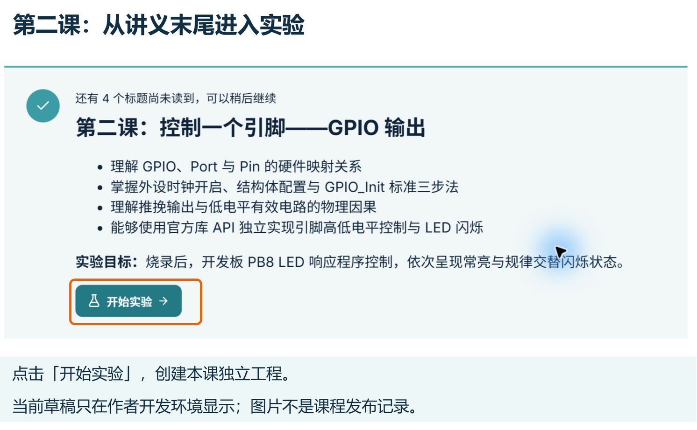
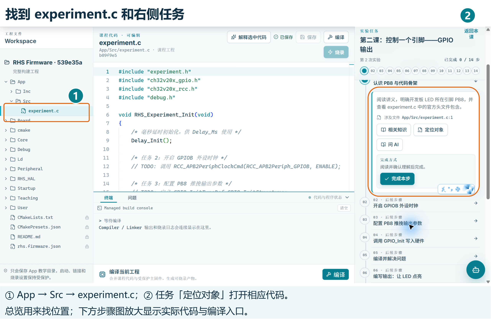
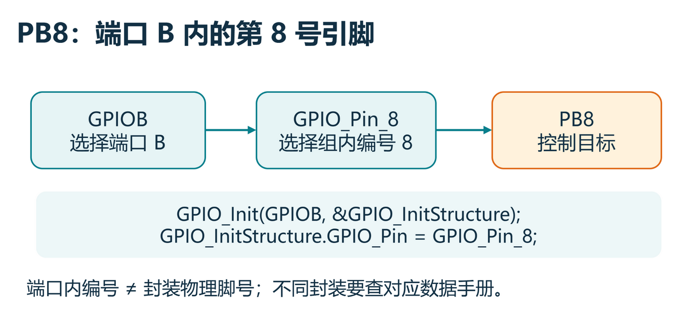
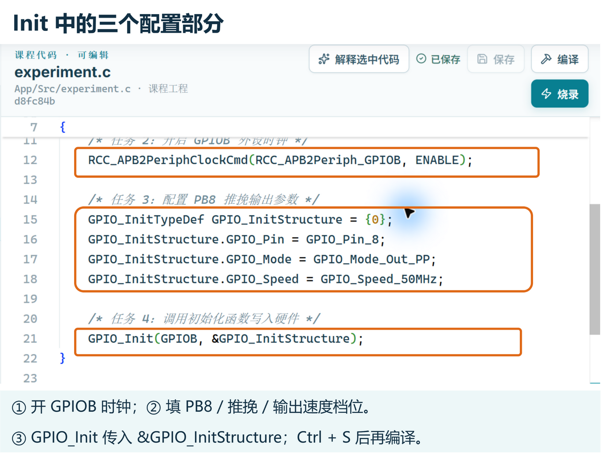
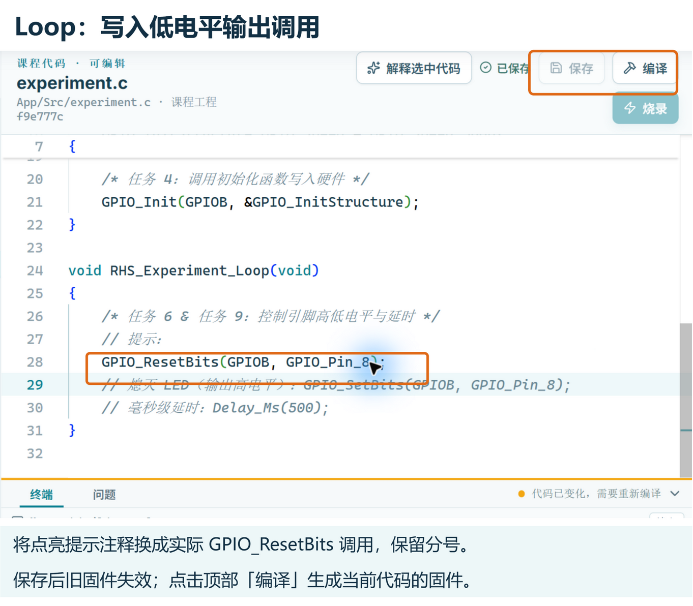
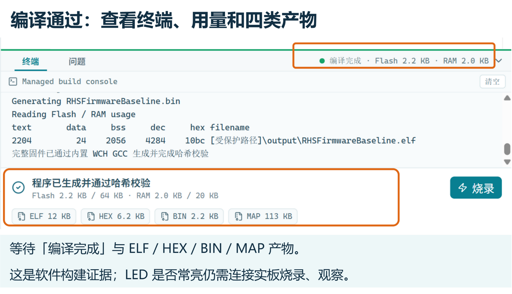
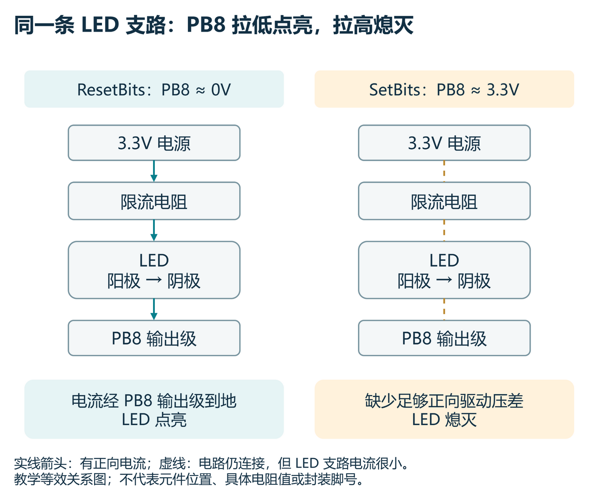
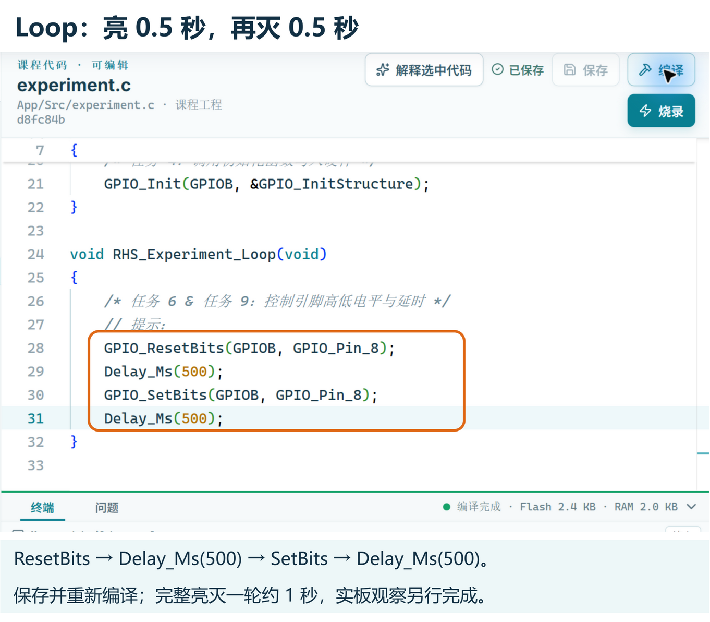
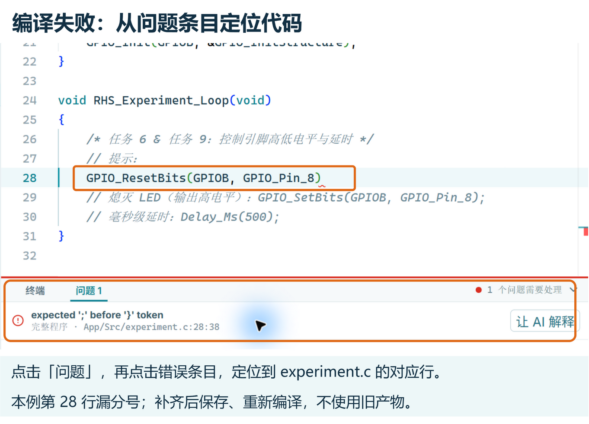

## 1. 从黑盒到白盒：单片机怎样伸出触角？ {#what-is-gpio}

在第一课中，你亲眼见证了一行 C 语言代码如何改变了现实中 LED 的闪烁速度。但当时我们使用的是高层教学封装函数 `RHS_Teaching_InitLed()` 与 `RHS_Teaching_ToggleLed()`。

你可能会好奇：**如果剥开这层封装，单片机底层到底是如何控制每一个真实引脚的？**

今天，我们将正式揭开这个“黑盒”，使用**沁恒官方标准外设库（CH32V20x SDK）**，亲手编写底层的引脚控制代码！

### 先进入本课工程 {#studio-entry}

在首页点击 **【进入课程】**，选中第二课并打开讲义；阅读后，在讲义末尾点击 **【开始实验】**。当前第二课尚未发布，课程作者的开发环境显示 **【开始作者验证】**；正式学生版暂时看不到这节课，等待真机验收完成后才开放。



实验会创建独立工程。左侧依次展开 **App → Src → experiment.c**；右侧任务中的 **【定位对象】** 也会打开同一文件，**【相关知识】** 返回当前任务对应的讲义。顶部保留文件路径，编辑前确认不是只读的 SDK 文件。



骨架中的 `// TODO:` 是注释，不会执行。本课要将它们替换为实际的 C 语句；保留四个头文件、`Delay_Init()` 和两个函数的花括号。按任务 2、3、4 分别填写并保存，每次用 **Ctrl + S** 或顶部 **【保存】**，等到显示 **已保存** 后再进行下一项。

右下角机器人打开 **AI 助教**，任务中的 **【问 AI】** 可以带入本步上下文。可问“`&GPIO_InitStructure` 的 `&` 有什么作用？只解释，不修改代码”，补充自己的疑问后按 Enter 发送，Shift + Enter 换行。AI 的解释或修改建议需要自己检查；任务勾选只记录操作与构建证据，不代表电路已经验证。

---

### 1. 什么是 GPIO？ {#gpio-concept}

在单片机芯片的四周，伸出了一排排银色的金属管脚。其中绝大多数管脚都可以由软件灵活配置为“输入信号”或“输出信号”，它们被称为 **GPIO（General Purpose Input/Output，通用输入输出端口）**。

- **输入（Input）**：监听外界信号。例如读取按键有没有被按下、传感器有没有检测到障碍物。
- **输出（Output）**：主动发出控制信号。例如在本课 3.3V 供电条件下，让引脚接近 3.3V 或 0V，用来控制板载 LED。电机、舵机等大电流器件需要驱动电路，不能直接靠 GPIO 供电。

:::concept[通用输入输出口（GPIO）]
GPIO 是单片机芯片伸向物理世界最基本的“电气触角”。通过软件配置，同一个引脚既可以作为输入感知外界电平，也可以作为输出主动控制外部电子元器件。
:::

---

### 2. 芯片管脚的分组管理：Port 与 Pin {#port-and-pin}

CH32V203 芯片拥有几十个引脚。如果逐个给引脚起乱七八糟的名字，管理起来会极其混乱。芯片设计者采用了**分组管理**的方式：

1. **端口（Port）**：将引脚按英文字母划分为大组，例如 `GPIOA`、`GPIOB`、`GPIOC` 等。每一组端口通常管理 16 个引脚；
2. **引脚编号（Pin）**：组内的每一个具体管脚用数字 $0 \sim 15$ 标记，例如 `Pin 0`、`Pin 1`、`Pin 8`。

二者组合起来，就构成了我们在工程原理图上看到的简写引脚名：
$$\text{Port B} + \text{Pin 8} = \mathbf{PB8}$$

在沁恒官方库中，它们被定义为标准的 C 语言符号：
- 端口对象：`GPIOB`
- 引脚编号：`GPIO_Pin_8`



**PB8 不是封装上从第一脚数起的第 8 个金属脚。** `B` 表示端口，`8` 表示端口内编号；`GPIO_Pin_8` 实际是选择该引脚的位掩码。芯片不同封装的物理脚号需要查对应数据手册。本课使用已经接好的板载 LED，无需自行数脚接线。

:::note[开发板上的硬件目标]
打开中央编辑器查看 `App/Src/experiment.c`，我们今天要控制的目标依然是那颗熟悉的绿色板载 LED。在硬件走线上，它正是连接在单片机的 **PB8** 引脚上！
:::

::code-target[查看 experiment.c 代码骨架]{path="App/Src/experiment.c" line="1"}

::task-link[完成任务：认识 PB8 与代码骨架]{step="find-hardware-target"}

---

## 2. 唤醒外设的第一步：开启外设时钟 {#clock-and-rcc}

### 1. 为什么引脚默认不会工作？ {#low-power-philosophy}

很多单片机初学者常常直接上手去配置引脚，结果发现引脚毫无反应，折腾几天才发现原因：**忘记开时钟了**！

单片机是一种极其注重低功耗的芯片。如果芯片一通电，内部所有外设（GPIO、串口、定时器、ADC 等）全部开足马力运转，会造成巨大的电量浪费和发热。

因此，芯片内部采用了一种**门控时钟机制（RCC，Reset and Clock Control）**：
> **GPIO 等外设的寄存器配置与正常运行需要相应的外设时钟。关闭时钟可以减少数字逻辑的动态功耗，但并不等于切断外设电源。**
> 在本课中，先开启 GPIOB 时钟，再配置 PB8。复位状态与已有程序是否开过时钟需要分开判断；不要依赖其他代码恰好替你初始化。

---

### 2. 官方 API：RCC_APB2PeriphClockCmd {#clock-api}

在 CH32V203 中，`GPIOB` 挂载在高速的 APB2 总线上。为了唤醒 GPIOB，我们需要调用沁恒官方库函数：

```c
RCC_APB2PeriphClockCmd(RCC_APB2Periph_GPIOB, ENABLE);
```

- **参数一**：`RCC_APB2Periph_GPIOB`，指定要开启的时钟目标是 GPIOB；
- **参数二**：`ENABLE`，使能（开启）时钟信号。

:::pitfall[开时钟就像进房间先开灯]
把时钟看成外设数字逻辑工作的节拍。没有启用对应时钟，后面的配置不能按预期完成。这个比喻帮助记住初始化顺序；时钟使能与接通供电是两个不同概念。
:::

::task-link[前往任务：开启 GPIOB 外设时钟]{step="enable-gpiob-clock"}

---

## 3. 引脚配置三步法：结构体与 GPIO_Init {#gpio-init-workflow}

时钟开启后，GPIOB 模块已经唤醒。但芯片依然不知道你想拿 PB8 做什么——是要检测按键输入？还是要输出电流点亮 LED？因此必须对引脚进行**模式配置**。

在官方标准库中，外设配置统一采用经典的**“三步走流程”**：

```
[1. 定义配置结构体] → [2. 填写引脚参数] → [3. 调用 GPIO_Init 盖章生效]
```

---

### 1. 填写参数申请表：GPIO_InitTypeDef {#gpio-struct}

沁恒官方外设库提供了一个专门用来描述 GPIO 配置的结构体类型：`GPIO_InitTypeDef`。

我们在 `RHS_Experiment_Init()` 中定义一个结构体变量，并填写三项核心参数：

```c
GPIO_InitTypeDef GPIO_InitStructure = {0};

/* 1. 指定我们要配置的具体引脚 */
GPIO_InitStructure.GPIO_Pin = GPIO_Pin_8;

/* 2. 指定工作模式：推挽输出 */
GPIO_InitStructure.GPIO_Mode = GPIO_Mode_Out_PP;

/* 3. 选择 GPIO 输出速度档位：50MHz */
GPIO_InitStructure.GPIO_Speed = GPIO_Speed_50MHz;
```

- **`GPIO_Pin_8`**：告诉芯片，这次配置只针对 8 号引脚，不影响同端口的其他引脚；
- **`GPIO_Mode_Out_PP`**：`PP` 代表 **Push-Pull（推挽输出）**。输出级可以主动拉高或拉低电平。本课只控制已经有限流电阻的板载 LED，输出电流仍须满足芯片规格；其他器件可能需要独立驱动电路；
- **`GPIO_Speed_50MHz`**：选择 SDK 提供的输出速度档位，沿用本课配置。它不会让 LED 自动以 50 MHz 闪烁，也不是循环的执行频率；本课的亮灭时间由 `Delay_Ms()` 决定。

---

### 2. 盖章生效：GPIO_Init {#gpio-init-call}

填好结构体后，这些参数目前还只是**电脑/内存里的普通变量**，芯片的硬件引脚电路并不知道它们的存在。

准确地说：编辑时它们是源码；程序烧录并运行后，结构体才是单片机 RAM 中的变量。`GPIO_Init()` 也要在单片机执行到这行代码时，才会修改 GPIO 寄存器。

必须调用官方初始化函数，把结构体里的参数真正刷入 CH32V203 的底层硬件控制寄存器中：

```c
GPIO_Init(GPIOB, &GPIO_InitStructure);
```

- 第一个参数 `GPIOB`：指定配置的目标端口；
- 第二个参数 `&GPIO_InitStructure`：传入刚才填好的配置结构体地址（注意前面的取地址符 `&`）。

:::tip[填表与办手续的比喻]
填写结构体就像在办事窗口“填写申请表格”；调用 `GPIO_Init()` 才是把表格递给窗口办事员“审核盖章并录入系统”。两步缺一不可！
:::

::task-link[前往任务：配置 PB8 推挽输出参数]{step="configure-gpio-struct"}

::task-link[前往任务：调用 GPIO_Init 写入硬件]{step="call-gpio-init"}

::task-link[前往任务：检查初始化代码语法]{step="candidate-build-init"}

### 在软件中检查初始化代码 {#build-init-guide}

把三个部分都写在 `RHS_Experiment_Init()` 的花括号里面，按 **Ctrl + S**。顶部显示 **已保存** 后点击 **【编译】**；任务 5 的 **【打开编译面板】** 用来展开底部面板，随后仍需点击面板里的 **【编译】**。



当前软件会执行完整的 Compiler / Linker 构建，不只是检查语法。等待终端出现 **编译完成**、ELF / HEX / BIN / MAP 产物与 Flash / RAM 用量。此时还未写入常亮代码，不能把这次构建当作常亮实验完成；填写 Loop 后必须再保存、再编译。

---

## 4. 控制高低电平：高电平、低电平与物理电路 {#logic-levels-and-circuit}

引脚已经成功配置为推挽输出模式。现在，单片机完全具备了向外输出电平的能力！

---

### 1. 认识电平输出 API {#write-pin-api}

沁恒官方库提供了两个最直观、执行效率最高的输出控制函数：

- **`GPIO_ResetBits(GPIOB, GPIO_Pin_8)`**：将 PB8 引脚电平**拉低**（输出 0V 低电平）；
- **`GPIO_SetBits(GPIOB, GPIO_Pin_8)`**：将 PB8 引脚电平**拉高**（输出 3.3V 高电平）。

---

### 2. 【预测与实验】：ResetBits 到底会让灯亮还是灭？ {#polarity-prediction}

现在请先停下来，在心里做一个预测：
> **`ResetBits`（清零/复位，输出 0V）与 `SetBits`（置位，输出 3.3V），你认为哪一个会让开发板上的 LED 点亮？**

很多初学者的第一直觉往往是：“1 代表有，0 代表无；所以高电平 Set 应该亮，低电平 Reset 应该灭”。

事实真的如此吗？让我们动手来验证！在 `RHS_Experiment_Loop()` 中写下一行代码：

```c
void RHS_Experiment_Loop(void)
{
    GPIO_ResetBits(GPIOB, GPIO_Pin_8); // 输出低电平 (0V)
}
```

保存代码，点击编辑器顶部 **【编译】**。代码变化后，旧固件会失效，烧录入口暂时禁用；等本次编译通过后，再连接第一课使用的 WCH-Link 与教学板，点击顶部 **【烧录】**。任务中的 **【打开烧录面板】** 只是打开面板入口。烧录完成后，观察开发板上的 PB8 LED；没有连接实板时，做到编译通过即可，暂不填写硬件观察。





---

### 3. 揭秘硬件原理图：低电平有效电路 {#active-low-explanation}

本课教学板的 PB8 LED 是低电平有效。正确烧录并运行后，**预期 PB8 LED 常亮**；请以自己实际观察到的结果为准。编译成功不能代替这个观察。

这是为什么？下面用简化的等效连接关系解释低电平有效；它不是开发板原理图截屏，也不标注具体封装脚号或电阻值：

```
[3.3V 电源供电]
      │
   [限流电阻]
      │
   [LED 阳极 +]  (正极)
   [LED 阴极 -]  (负极)
      │
[CH32V203 PB8 引脚]
```



LED 需要**正向偏置且有足够的电流**才会发光；串联电阻负责限流，不能省略。

1. **当单片机输出低电平（0V）时**：  
   PB8 被拉到接近 0V，电流从 3.3V 电源经过限流电阻和 LED，再进入 PB8 的输出级到地，**LED 点亮**。3.3V 会分配在电阻、LED 和输出级上，不能把 LED 自身的压降简单写成 3.3V。
2. **当单片机输出高电平（3.3V）时**：  
   PB8 被拉到接近 3.3V，LED 支路缺少足够的正向驱动压差，电流很小，**LED 熄灭**。

这种“输入低电平时器件工作”的电路连接方式，在电子工程中被称为 **低电平有效（Active-Low）**。

:::note[逻辑电平 vs 物理状态]
在单片机开发中，永远不要想当然地认为“高电平就一定等于开”。引脚输出的高低电平到底产生什么物理动作，完全取决于外部电路是怎样搭建的！
:::

::task-link[前往任务：编写输出让 LED 点亮]{step="write-led-level"}

::task-link[前往任务：编译完整点亮程序]{step="firmware-build-on"}

::task-link[前往任务：写入开发板（点亮）]{step="flash-board-on"}

::task-link[前往任务：观察 PB8 LED 常亮]{step="observe-led-polarity"}

---

## 5. 综合实战：编写纯官方 SDK 的闪烁程序 {#full-blink-practice}

既然我们已经验证了：
- `GPIO_ResetBits(GPIOB, GPIO_Pin_8)` $\rightarrow$ **点亮**
- `GPIO_SetBits(GPIOB, GPIO_Pin_8)` $\rightarrow$ **熄灭**

那么把它们组合起来，中间穿插等待延时，不就能实现完整的规律闪烁了吗？

---

### 1. 构建闪烁时序 {#blink-timing}

在 `App/Src/experiment.c` 中，将 `RHS_Experiment_Loop()` 完善为以下时序：

```c
void RHS_Experiment_Loop(void)
{
    /* 1. 点亮 LED (输出低电平) */
    GPIO_ResetBits(GPIOB, GPIO_Pin_8);

    /* 2. 保持点亮状态等待 500 毫秒 (0.5 秒) */
    Delay_Ms(500);

    /* 3. 熄灭 LED (输出高电平) */
    GPIO_SetBits(GPIOB, GPIO_Pin_8);

    /* 4. 保持熄灭状态等待 500 毫秒 (0.5 秒) */
    Delay_Ms(500);
}
```

因为系统底层会永不停歇地循环调用 `RHS_Experiment_Loop()`，所以整个执行过程将是：  
`点亮 0.5s` $\rightarrow$ `熄灭 0.5s` $\rightarrow$ `点亮 0.5s` $\rightarrow$ `熄灭 0.5s`……形成持续优美的交替闪烁！

---

### 2. 编译、烧录与终极验证 {#final-verification}

保存代码后：
1. 点击顶部 **【编译】**；任务 11 的 **【打开编译面板】** 可以展开终端；
2. 确认当前代码编译成功、问题已清除后，连接实板并点击顶部 **【烧录】**；
3. 烧录完成后，观察 PB8 LED，预期约亮 0.5 秒、灭 0.5 秒，完整一轮约 1 秒。记录真实现象再完成硬件任务。



图中每条调用都有分号，ResetBits 和 SetBits 各配一个 `Delay_Ms(500)`。截图中的任务计数只反映制作时的软件操作，硬件步骤需要你自己执行；没有实板时保持未完成，不填写猜测的 LED 现象。

回想一下第一课：当时你调用的是别人封装好的 `RHS_Teaching_InitLed()` 与 `RHS_Teaching_ToggleLed()`。  
而现在，**从外设时钟开启、推挽输出配置、硬件初始化，到高低电平控制，整套程序 100% 都是由你亲自调用的沁恒官方标准外设库代码！** 你已经真正推开了嵌入式底层开发的大门！

::task-link[前往任务：改写 Loop 实现闪烁]{step="edit-blink-loop"}

::task-link[前往任务：编译完整闪烁程序]{step="firmware-build-blink"}

::task-link[前往任务：写入开发板（闪烁）]{step="flash-board-blink"}

::task-link[前往任务：观察 PB8 LED 闪烁]{step="observe-led-blink"}

---

## 6. 常见问题排查、思考反思与小结 {#troubleshooting-and-summary}

### 1. 新手常见问题排查清单 {#troubleshooting}

如果编译失败，先点击底部 **【问题】**，再点击错误条目，编辑器会定位对应文件与行号。例如 `expected ';' before '}' token` 常见于前一条语句漏写分号；按提示检查附近代码，补齐后保存、重新编译。也可点击 **【让 AI 解释】**，先理解原因，再决定如何修改。



- **问题一：烧录成功后，LED 依然不亮也不闪？**
  - **排查时钟**：检查是否漏掉了 `RCC_APB2PeriphClockCmd(RCC_APB2Periph_GPIOB, ENABLE);`？
  - **排查端口**：检查 `GPIO_Init` 和 `GPIO_ResetBits` 的第一个参数是否误写成了 `GPIOA`？
  - **排查取地址符**：检查 `GPIO_Init(GPIOB, &GPIO_InitStructure)` 中是否漏掉了 `&`？
- **问题二：编译报错提示未定义符号？**
  - 检查头文件是否完整包含了 `#include "ch32v20x_gpio.h"` 和 `#include "ch32v20x_rcc.h"`；
  - 检查官方宏命名的大小写：C 语言对大小写严格敏感，如 `GPIO_Pin_8` 不能写成 `gpio_pin_8`。

---

### 2. 想一想：核心概念反思 {#reflection}

实验完成后，请在右侧任务栏最后一步提交对以下两道核心思考题的回答：

1. **为什么在配置 GPIOB 引脚之前，必须先调用 `RCC_APB2PeriphClockCmd` 打开外设时钟？**
2. **在我们的机器马开发板上，为什么调用 `GPIO_ResetBits`（输出低电平）反而会让 LED 点亮？**

::task-link[完成课后思考题]{step="reflect-gpio-concepts"}

---

### 3. 本课小结与后续展望 {#summary}

在第二课中，你掌握了单片机开发最重要的核心基本功：
- **GPIO 概念**：通用输入输出口是单片机连接外界的电气通道；
- **时钟门控（RCC）**：配置 GPIOB 前先开启其外设时钟；时钟使能不等于接通电源；
- **标准初始化三步走**：定义结构体 $\rightarrow$ 填写参数 $\rightarrow$ 调用 `GPIO_Init` 写入硬件；
- **推挽输出与低电平有效**：理解了逻辑电平与硬件电路走线之间的物理配合关系。

目前我们掌握的都是单片机**向外输出（Output）**。那单片机如何**感知外界的输入（Input）** 呢？比如当我们按下一颗微动开关按键时，单片机怎样获知并立即做出响应？  
在下一课中，我们将继续探索 GPIO 的另一半能力——**GPIO 输入与按键检测**！
