## 第一课：认识单片机，用 Studio 控制两路灯 {#introduction}

欢迎来到单片机开发世界！本课程专为零基础初学者量身打造，无需提前掌握复杂的电子电路或深奥的芯片微架构。今天我们只聚焦三个最核心的问题：

1. **单片机是什么？** 它与我们平时用的电脑、手里的电路板有什么区别？
2. **程序如何跨越虚拟与现实？** 一行 C 语言代码是怎样让现实中的灯按照你的意志改变亮灭的？
3. **现代嵌入式利器 SysConfig 是做什么的？** 为什么我们要用图形化工具来配置芯片引脚和外设？

在本课中，你将亲自动手经历三次由浅入深的实验：
- **实验 A**：编译烧录默认工程，亲眼见证板载绿色灯按默认节奏闪烁；
- **实验 B**：修改代码中的延时参数，让绿色灯的闪烁节奏明显变慢；
- **实验 C**：使用德州仪器官方图形化工具 **SysConfig** 新增蓝色灯通道，并在代码中控制它闪烁！

只要跟着讲义一步步操作，你就能轻松跑通“修改代码/配置 → 编译 → 烧录 → 观察”的完整工程闭环。

---

### 1. 认识单片机：装在芯片里的微型计算机 {#what-is-mcu}

想一想身边的日常电子设备：电饭煲如何自动定时和保温、无人机如何保持平稳飞行、机器马如何协调四肢行走？这些设备虽然形态各异，但背后都有一颗负责运算并实时控制硬件的“微型大脑”——**单片机**。

单片机在行业中通常被称为 **MCU（Microcontroller Unit，微控制器）**。与我们平时用的台式电脑或笔记本不同：
- **普通电脑**：追求通用算力，用来浏览网页、处理文档、运行大型软件，体积大、功耗高；
- **单片机**：体积微小（通常只有指甲盖大小）、功耗极低、通电瞬间就能工作，专门负责**精确测量传感器信号并实时控制外部电子设备**。

它把计算机的核心部件——负责运算的 CPU、存放代码和数据的存储区（Flash 和 RAM）、以及与外界通信的引脚控制电路，全部集成在了一颗芯片里。

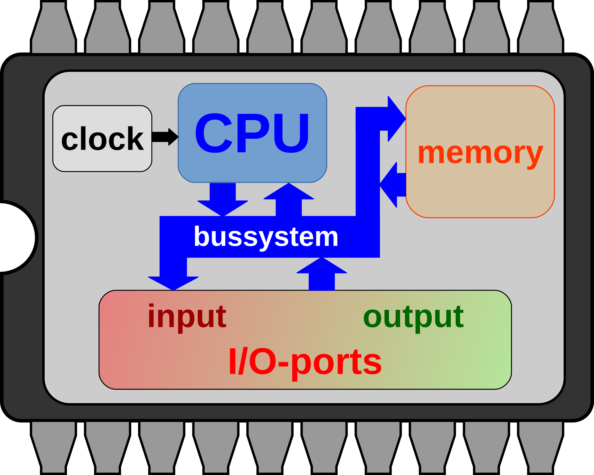

上面这幅微架构概念图清晰展示了单片机内部四大核心模块的协同分工：
- **CPU（运算核心）**：单片机的“大脑中枢”，负责读取并执行程序指令；
- **Memory（存储器）**：单片机的“记忆仓库”，包含断电后仍能保存程序的 Flash 和运行中暂存变量的 RAM；
- **Clock（时钟系统）**：单片机的“心跳节拍”，为处理器和相关外设提供运行节拍；
- **I/O-ports（输入输出端口）**：单片机的“触角手脚”，通过四周管脚与外界连接，感知传感器电平或输出信号驱动指示灯；
- 各部件通过芯片内部的高速**总线（bussystem）**紧密交织，共同构成了这颗五脏俱全的微型计算机。

> *注：上图为单片机通用组成概念图，不代表 MSPM0G3507 的内部布局或封装引脚。具体管脚定义以对应型号的数据手册为准。图片：jiricek72，[Openclipart 原作](https://openclipart.org/detail/252719/microcontroller-simple-scheme)，CC0 / Public Domain。*

:::concept[微控制器（MCU）]
单片机（MCU）是将计算机的核心部件全部集成在一颗芯片上的微型计算机，专用于自动化控制与电子设备操作。在嵌入式开发中，单片机与 MCU 通常指同一个概念。
:::

---

### 2. 单片机与现实世界：输入与输出模型 {#input-output}

单片机本身只是一颗芯片。四周伸出的一排排金属小细腿叫作**引脚（Pin）**。单片机正是通过这些引脚与外部世界连结，构成了经典的“输入—处理—输出”模型：

| 类别 | 角色定位 | 典型器件 | 在机器马系统中的分工 |
| :--- | :--- | :--- | :--- |
| **输入（Input）** | 收集环境信号，告诉单片机“发生了什么” | 按键、光电传感器、红外测距、摄像头 | 感知地面黑线、检测前方是否有障碍物 |
| **核心处理（MCU）** | 运行程序代码，根据输入做出计算与决策 | **MSPM0G3507SPMR**（开发板中央的主控芯片） | 分析环境信息、协调四肢动作、控制机身保持平衡 |
| **输出（Output）** | 接收单片机电平指令，转化为物理动作 | LED 指示灯、蜂鸣器、舵机、驱动电机 | 驱动马腿摆动、发出蜂鸣报警、闪烁状态指示灯 |

无论是今天控制一颗小小的 LED，还是以后控制整只机器马奔跑，整个系统的骨架都是相通的：  
`[外界传感器信号输入] → [单片机运行程序做出决策] → [控制引脚输出动作（驱动马腿或点亮 LED）]`。

---

### 3. 概念辨析：单片机芯片 vs 教学开发板 {#chip-and-board}

初学者最容易将“整块电路板”误认为单片机。请明确区分：

- **单片机芯片（MCU）**：特指电路板中央那颗负责执行指令的方形芯片（本课程使用 **TI MSPM0G3507SPMR**，基于 32 位 ARM Cortex-M0+ 内核）。
- **教学开发板（Board）**：是以单片机为核心，在其外围配套了供电电路、调试下载接口、排针、按键以及板载全彩 RGB LED 灯的整套实验学习底板。开发板为芯片铺好了线路，免去了我们自己焊接电路的麻烦，让我们插上调试线就能直接编程。

**认识板载 RGB 全彩 LED：**
在开发板中央有一颗贴片 RGB LED。虽然外观上看起来是一颗灯珠，但它内部其实封装了红（Red）、绿（Green）、蓝（Blue）三个独立的颜色发光通道。它们分别连接在单片机的不同引脚上：
- **绿色通道**：连接在 **PA26** 引脚；
- **蓝色通道**：连接在 **PA6** 引脚；
- **红色通道**：连接在 **PA5** 引脚。

三路通道在电气设计上均为**低电平点亮**（后面我们会深入讲解其中的电路奥秘）。

:::note[为什么从板载 LED 开始？]
LED（发光二极管）是最直观的硬件“探针”。单片机通过内部程序控制引脚电平，LED 就会亮起或熄灭。亲眼看到灯光的颜色和闪烁节奏按你的代码改变，才能确凿证明新程序已经真正进入了单片机并接管了硬件！
:::

:::safety[接线前先断电，认准接口丝印]
本课专注文档与 LED 实验，不涉及电机和动力电源。接线前请断开电源；使用 CMSIS-DAP 调试器连接开发板的 SWD 接口时，请严格核对板上的引脚丝印标识：确认 **3.3V、GND、SWDIO、SWCLK** 正确对应。千万不要按排线颜色盲目猜测引脚，**严禁将 5V 电源接到芯片的 3.3V 信号脚**，以免烧毁芯片。
:::

---

## 认识 Studio：从课程进入自己的实验工程 {#studio-tour}

在电脑屏幕上运行的 **RoboHorse Studio** 是我们进行单片机开发的一体化平台。它集成了讲义阅读、代码编辑、图形化配置、固件编译和一键烧录等完整功能。

只需 4 步即可开启实验：

1. 打开 **TI MSPM0 版本**的 RoboHorse Studio，在首页点击 **【课程学习 → 进入课程】**；
2. 选择 **TI MSPM0 单片机入门**，打开本课讲义；
3. 阅读讲义后，滚动到讲义末尾，点击 **【开始实验】** 按钮，Studio 会自动为你创建一份独立的实验工程副本（放手尝试修改，不用担心改坏课程模板！）；
4. 在左侧工程文件树中打开 **`src/main.c`**；在后面的实验中，我们还会用到芯片配置文件 **`gpio_toggle_output.syscfg`**。

先对照真实界面熟悉软件操作流程。下图按“首页 → 课程中心 → 讲义阅读 → 开始实验”的操作动线完整呈现（点击图片可放大查看原图细节）：


:::note[关于界面上的状态徽标]
本课截图来自作者开发环境，所以课程中心显示“作者验证”橙色徽标。本课仍待实板验收，学生正式版本暂不开放。课程发布后，以实际按钮文字为准；讲义末尾的“开始实验”会创建独立工程，修改工程不会改变课程模板。截图中的图框和编号是教学标注，软件本身不显示这些标注。
:::

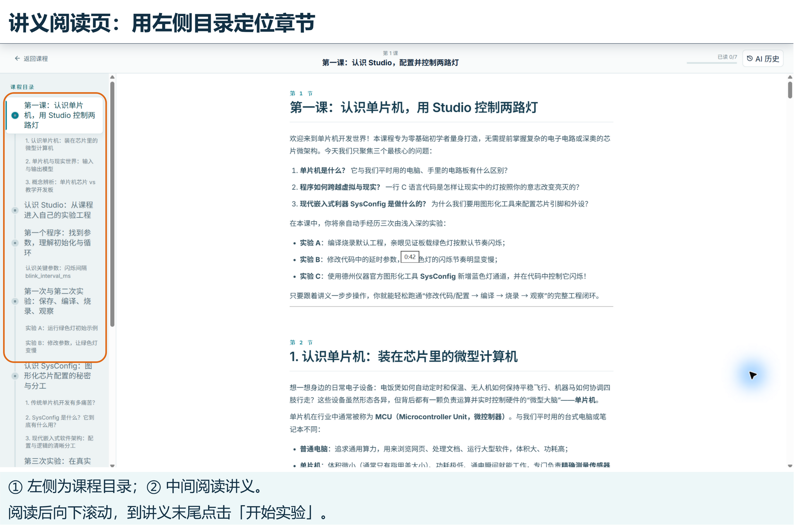

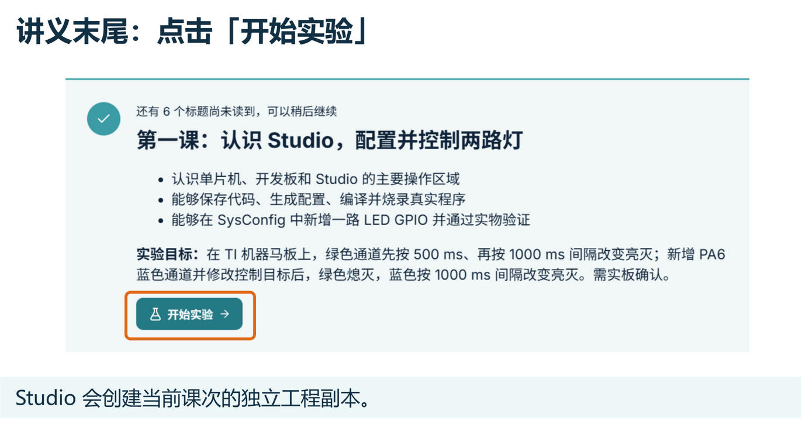

进入实验后，先认清工作台的常用区域，不必一开始记住所有按钮：

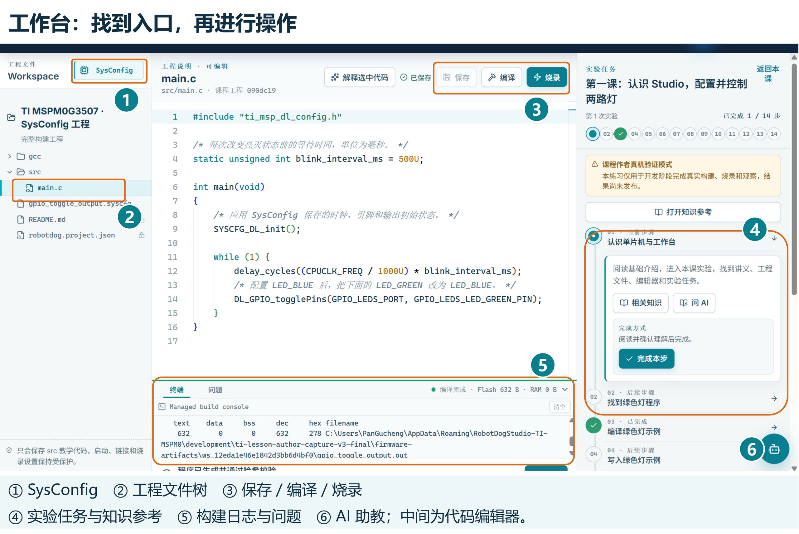

| 区域 | 你在这里做什么 | 本课的实操对应 |
| :--- | :--- | :--- |
| **① SysConfig 按钮** | 打开当前工程的图形化芯片配置；位于左上角文件树旁 | 新增 PA6 蓝色通道 |
| **② 工程文件树** | 浏览和打开当前工程中的源文件与配置文件；先展开 `src` | 点击打开 `src/main.c` |
| **代码编辑器** | 编写与修改 C 语言代码，检查文件保存状态 | 将 `500U` 改为 `1000U` |
| **③ 保存 / 编译 / 烧录按钮** | 依次保存当前文件、构建当前工程、写入开发板；位于编辑器右上方 | 每次修改后重新保存、编译、烧录 |
| **④ 实验任务与知识参考** | 跟随步骤操作并记录观察；点击“打开知识参考”可返回对应讲义 | 阅读“新增蓝色通道”并记录灯光现象 |
| **⑤ 底部日志与问题** | 查看 SysConfig 代码生成、GCC 编译和烧录日志 | 遇到错误时查看第一条有效提示 |
| **⑥ AI 助教** | 点击右下角机器人，打开可移动、可调整大小的提问窗口 | 请它解释参数、提示检查顺序，或帮助理解报错 |

讲义中的“打开程序”和“前往任务”蓝色链接可以直接带你定位到目标位置；定位链接本身不会替你执行操作，放手跟随步骤动手实践吧！

::task-link[前往实验任务]{step="read-intro"}

### 使用 AI 助教：把疑问说清楚 {#ai-tutor}

如果读完讲义仍有疑问，可以点击工作台右下角的**机器人按钮**打开 AI 助教。在当前任务卡片中点击 **【问 AI】**，也能打开助教，并准备一个围绕当前步骤的提问；先读一遍输入框里的问题，按需要补充后再发送。


1. 在输入框写下你正在做哪一步、看到了什么、哪里不理解；按 **Enter** 发送，**Shift + Enter** 换行。
2. 想理解代码时，先在编辑器选中一小段代码，再点击上方 **【解释选中代码】**。例如选中 `blink_interval_ms` 所在的一行，请助教解释参数的作用。
3. 助教挡住操作区域时，可以拖动窗口顶部把它移开，拖动右下角调整大小；点右上角 **×** 收起，再点机器人可以重新打开。

试着这样提问：

- “`blink_interval_ms = 500U` 中的 U 是什么意思？为什么一轮亮灭约为 1 秒？”
- “我已经在 SysConfig 保存 LED_BLUE，但编译提示蓝色宏未定义。请告诉我先检查哪两个地方，暂时不要改代码。”

助教可以解释知识，也可以协助修改代码。第一课建议先请它给提示，再亲自操作。如果它生成了代码修改，先查看 **【修改确认】** 中的差异，理解后选择 **【接收并保存】**，再重新编译；不采用时选择 **【放弃修改】**。最后仍要通过烧录和真实观察确认 LED 现象。

:::note[如果助教提示“尚未就绪”]
请按面板提示打开软件设置，或请老师协助完成 AI 配置。配置完成后重新打开助教即可提问；本课的编辑、SysConfig 配置和编译操作也可以按讲义独立完成。
:::

---

## 第一个程序：找到参数，理解初始化与循环 {#gpio-program}

开发单片机不需要一开始就背诵厚厚的 C 语言语法书。在实际工程中，我们推崇 **“用到什么，就认识什么”**。

::code-target[在编辑器中打开 main.c]{path="src/main.c" line="1"}

在中央编辑器中打开 `src/main.c`，你会看到精炼的实验代码：

```c
#include "ti_msp_dl_config.h"

/* 每次改变亮灭状态前的等待时间，单位为毫秒 (ms) */
static unsigned int blink_interval_ms = 500U;

int main(void)
{
    /* 应用 SysConfig 保存的时钟、引脚和输出初始状态 */
    SYSCFG_DL_init();

    while (1) {
        delay_cycles((CPUCLK_FREQ / 1000U) * blink_interval_ms);
        /* 当前控制绿色通道；在第三次实验中会替换为蓝色通道 */
        DL_GPIO_togglePins(GPIO_LEDS_PORT, GPIO_LEDS_LED_GREEN_PIN);
    }
}
```

单片机程序的运行规律有两个非常鲜明的特点：

1. **开机初始化只执行一次**：`SYSCFG_DL_init()` 在单片机通电开机瞬间最先运行。它负责把我们在 SysConfig 中配置好的时钟频率、GPIO 引脚方向以及初始电平一次性装载到芯片的硬件寄存器中，做好所有开工准备（称为**初始化**）。
2. **主业务无限循环**：家用电器和机器人通电后通常需要一直工作，绝不会自己退出。`while (1)` 是一个永不退出的死循环，系统会在其中周而复始地重复两件事：
   - **等待一段时间**：`delay_cycles(...)` 根据芯片的主频时钟（`CPUCLK_FREQ`）与我们设定的毫秒数，精确计算并消耗所需的 CPU 时钟周期数，从而产生时间延时；
   - **翻转引脚电平**：`DL_GPIO_togglePins(...)` 是 TI 官方驱动库（DriverLib）提供的引脚翻转函数，每次执行都会让指定引脚的高低电平交替变换（高变低、低变高），驱动 LED 在亮和灭之间切换。

代码中的 `GPIO_LEDS_PORT`（引脚所在端口）和 `GPIO_LEDS_LED_GREEN_PIN`（绿色通道引脚编号）都是 SysConfig 帮我们自动生成的标准宏名称。我们在 `main.c` 中直接使用它们即可，根本不需要手动去查复杂的底层寄存器地址！

---

### 认识关键参数：闪烁间隔 blink_interval_ms {#blink-parameter}

在代码第 4 行，找到控制闪烁节奏的关键变量：

```c
static unsigned int blink_interval_ms = 500U;
```

初学时不必深究 `static` 或 `unsigned int` 的复杂语法定义，只需掌握两点：
- **数值与单位**：`500` 代表等待时间为 500 毫秒（$\text{ms}$）。换算关系为：$1000\text{ ms} = 1\text{ 秒}$，所以 $500\text{ ms} = 0.5\text{ 秒}$。
- **书写规范**：末尾的字母 `U` 是 C 语言中表示正整数（Unsigned）的符号。**修改时只需修改数字本身，切记保留末尾的 `U` 和分号 `;`（例如改为 `1000U`）**。

> **特别提示**：这个参数代表**相邻两次改变亮灭状态之间的等待时间**，而不是一个完整的“亮—灭”周期。500 ms 的翻转间隔意味着：灯亮约 0.5 秒，接着灯灭约 0.5 秒，完成一轮完整的“亮 + 灭”循环总共耗时约 1 秒。

---

## 第一次与第二次实验：保存、编译、烧录、观察 {#validation-workflow}

初学嵌入式最容易产生一个困惑：“为什么我在编辑器里改了代码，开发板上的灯却毫无变化？”  
原因在于：**电脑屏幕上显示的代码只是文本文件，而真正执行指令的是桌面上的开发板硬件**。从修改代码到看到硬件改变，必须完整走过四个阶段：

| 步骤阶段 | 发生在哪里 | 做什么事情 | 产生的结果 |
| :--- | :--- | :--- | :--- |
| **1. 保存修改** | 电脑编辑器 | 修改参数（如 `blink_interval_ms`）并保存 | 磁盘上的源文件完成更新 |
| **2. 编译代码** | 电脑工具链 | 工具链先运行 SysConfig 生成驱动代码，再调用 Arm GCC 编译器检查语法并翻译 | 生成单片机可运行的二进制固件文件 |
| **3. 烧录程序** | 电脑通过调试线 | 将编译好的程序固件写入 MSPM0G3507 芯片内部的 Flash 存储区 | 芯片载入最新程序并自动复位重启 |
| **4. 观察验证** | 真实开发板 | 芯片引脚输出电平信号，驱动硬件元器件动作 | 板载 LED 颜色或闪烁速度发生真实改变 |

:::pitfall[编译成功 ≠ 已经写入开发板]
在软件中提示“构建成功”，仅仅说明代码没有语法错误，并在电脑里生成了供芯片使用的程序镜像。此时新程序依然只停留在电脑里！必须点击 **【烧录】**（或 **【写入开发板】**），最新程序才会被刷入单片机芯片并开始运行。
:::

---

### 实验 A：运行绿色灯初始示例 {#first-green}

在进行任何修改前，我们先验证默认工程和硬件链路是否完好：

1. 先不要修改任何代码；
2. 确认开发板与电脑已通过调试器连接妥当；
3. 点击 Studio 顶部的 **【编译】** 按钮（或实验任务栏中的对应步骤），等待终端日志提示构建成功；
4. 点击 **【烧录】** 按钮（或实验任务栏中的 **【写入开发板】**），等待日志提示校验和复位完成；
5. 观察开发板中央附近的板载 RGB LED：此时**绿色通道**应该以每隔约 0.5 秒改变一次亮灭的节奏闪烁（亮 0.5 秒、灭 0.5 秒，约 1 秒完成一轮）；
6. 在右侧任务栏“记录绿色灯初始现象”中记录你看到的真实状态，点击 **【保存观察】**。

::task-link[编译绿色灯初始示例]{step="build-green"}

::task-link[记录绿色灯初始现象]{step="observe-green"}

---

### 实验 B：修改参数，让绿色灯变慢 {#slow-green}

现在我们动手验证代码修改如何影响现实硬件：

1. 打开 `src/main.c`，找到 `blink_interval_ms`，将 **`500U`** 修改为 **`1000U`**；
2. 点击编辑器的 **【保存】** 按钮（或按键盘快捷键 `Ctrl + S`），确认编辑器右上角状态显示为绿色的“已保存”；
3. 重新点击 **【编译】**，等待固件构建完成；
4. 重新点击 **【烧录】**，将新固件写入开发板；
5. 观察绿灯的闪烁节奏：此时它会以约 1 秒亮、1 秒灭的平缓节奏交替闪烁，闪烁速度明显比实验 A 慢了一倍！在任务栏中记录你的观察。

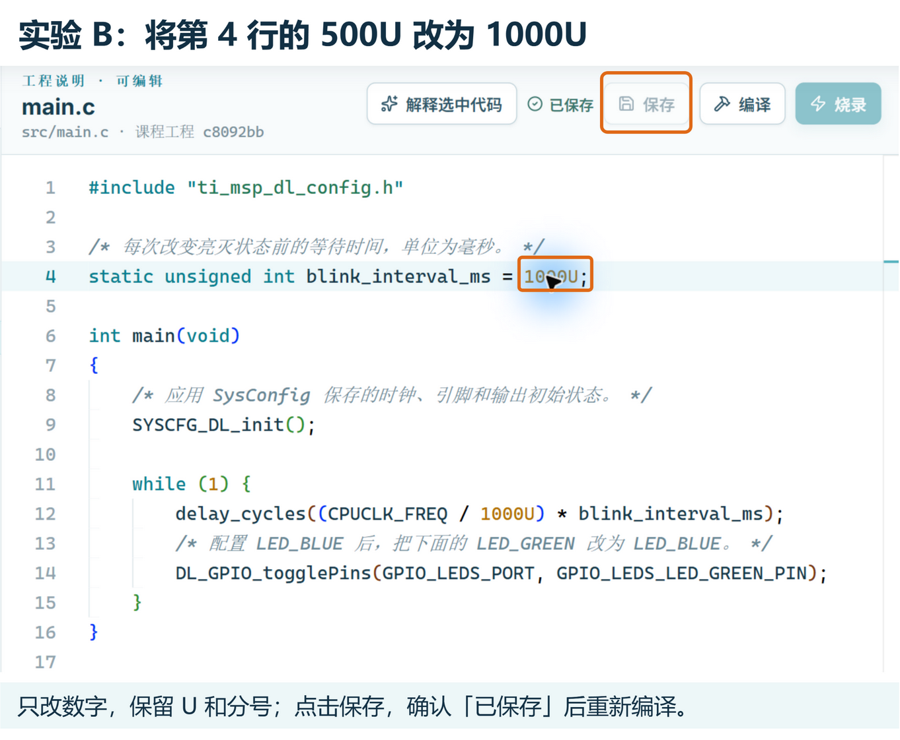

```c
/* 修改前：每次翻转等待 0.5 秒 */
static unsigned int blink_interval_ms = 500U;

/* 修改后：每次翻转等待 1.0 秒 */
static unsigned int blink_interval_ms = 1000U;
```

:::tip[保存状态与单变量原则]
编辑器提示“有未保存修改”时，顶部的编译按钮会被保护性禁用，请先按 `Ctrl + S` 保存。本次修改严格遵守“单变量控制”原则：只改数字本身，不改动周围的 `U`、分号 `;` 或其他语句。
:::

::task-link[修改绿色灯闪烁间隔]{step="edit-interval"}

::task-link[记录绿色灯变慢后的现象]{step="observe-slow-green"}

---

## 认识 SysConfig：图形化芯片配置的秘密与分工 {#workflow}

在前两个实验中，我们只是在现有代码里改动了一个时间数字。但如果你是一名嵌入式工程师，需要为一个全新的引脚配置功能（例如点亮另一颗灯、接入一个按键），该怎么做呢？

这就引出了嵌入式开发中最核心的工具之一——**TI SysConfig**。

---

### 1. 传统单片机开发有多痛苦？ {#legacy-pain}

想象一下，如果没有图形化工具，传统的单片机开发是怎样的：
1. **啃上千页手册**：为了让某个引脚输出高低电平，你必须翻开厚达上千页的芯片英文《技术参考手册》（TRM）和数据手册；
2. **算寄存器位**：查阅该引脚对应哪个 GPIO 端口、控制时钟的寄存器地址是多少、输入输出模式寄存器的第几位要写 1 还是写 0；
3. **手写晦涩代码**：在代码里手写一长串晦涩难懂的指针和位运算代码（如 `*(volatile uint32_t *)0x400A0000 |= (1 << 6);`）；
4. **痛苦排错**：只要不小心算错了一位数字，或者两个外设误用了同一个管脚（**引脚冲突**），芯片就会诡异报错或直接罢工，排查几天几夜都找不出原因！

---

### 2. SysConfig 是什么？它到底有什么用？ {#what-is-sysconfig}

为了终结这种繁琐易错的开发体验，德州仪器（TI）推出了 **SysConfig（System Configuration Tool，系统配置工具）**。

简单来说，**SysConfig 就是你的“图形化芯片管家”**！它把复杂的芯片底层硬件配置变成了直观的图形化界面操作，具备三大核心超能力：

1. **可视化搭积木配置**：无需记忆寄存器地址。在直观的图形界面中点选你需要的外设（如 GPIO、串口、定时器、ADC），通过下拉框设定引脚编号、方向（输入/输出）和初始电平；
2. **火眼金睛的引脚防冲突检测（PinMux）**：单片机引脚资源非常宝贵，许多引脚身兼数职。如果你不小心把已被占用的引脚分配给了另一个外设，SysConfig 会在界面上立刻标出刺眼的**红色叉号警告**，并明确告诉你哪个引脚与谁冲突了，在编写代码前就把硬件级低级错误消灭在萌芽状态；
3. **自动生成标准驱动代码**：配置完成后，先在 SysConfig 里保存 `.syscfg` 文件。下一次点击 Studio 的 **【编译】**，工具链会调用 SysConfig，将你的点选转化为标准规范的 C 语言底层驱动代码（生成在 `generated/` 目录中），提供一键初始化函数 `SYSCFG_DL_init()` 以及清晰语义的宏定义（如 `GPIO_LEDS_PORT`、`GPIO_LEDS_LED_BLUE_PIN`）。

:::concept[TI SysConfig]
SysConfig 是德州仪器官方推出的图形化芯片外设配置与代码生成工具。它通过图形界面让开发者直观配置引脚、时钟与外设，自动检测硬件资源冲突，并一键生成标准驱动代码，使开发者免于繁杂的底层寄存器计算。
:::

---

### 3. 现代嵌入式软件架构：配置与逻辑的清晰分工 {#architecture-separation}

在 MSPM0 工程中，**硬件配置**与**业务逻辑**是彻底解耦、分工协作的：

| 文件 / 目录 | 负责什么角色 | 如何维护 | 示例 |
| :--- | :--- | :--- | :--- |
| **`gpio_toggle_output.syscfg`** | **硬件资源配置**：芯片型号、用哪个引脚、引脚方向是输入还是输出、初始电平是高还是低 | 使用官方 **SysConfig GUI** 图形化点选并保存 | 在界面中添加 `LED_BLUE`，绑定 `PA6` |
| **`generated/` 目录代码** | **底层驱动代码桥梁**：将 `.syscfg` 中的配置转化为 C 语言初始化函数和引脚宏定义 | 每次编译前由 SysConfig **自动重新生成，严禁手动修改** | `SYSCFG_DL_init()`、`GPIO_LEDS_LED_BLUE_PIN` |
| **`src/main.c`** | **顶层业务行为逻辑**：开机后做什么、灯按什么节奏闪、机器马何时迈腿 | 由开发者在 **Studio 代码编辑器** 中亲手编写 | 调整 `blink_interval_ms`，调用 `DL_GPIO_togglePins` |

它们之间的协作流水线非常清晰自然：

**在 SysConfig 中配置并保存 → 在 Studio 中保存 `main.c` → 点击编译，生成驱动并编译固件 → 烧录 → 观察开发板。**

分工确立后，你就可以放心把底层寄存器交给 SysConfig 管理，自己专注于编写真正有趣的顶层应用逻辑！

::task-link[理解配置与程序的分工]{step="learn-sysconfig"}

### 4. 先认识整窗：入口和各区域在哪里？ {#sysconfig-window-tour}

从工作台左上角打开 **SysConfig** 后，点击窗口右上角的最大化按钮，让外设导航、配置区和芯片图同时显示。先按下面的编号认清位置，再跟随下一章动手。

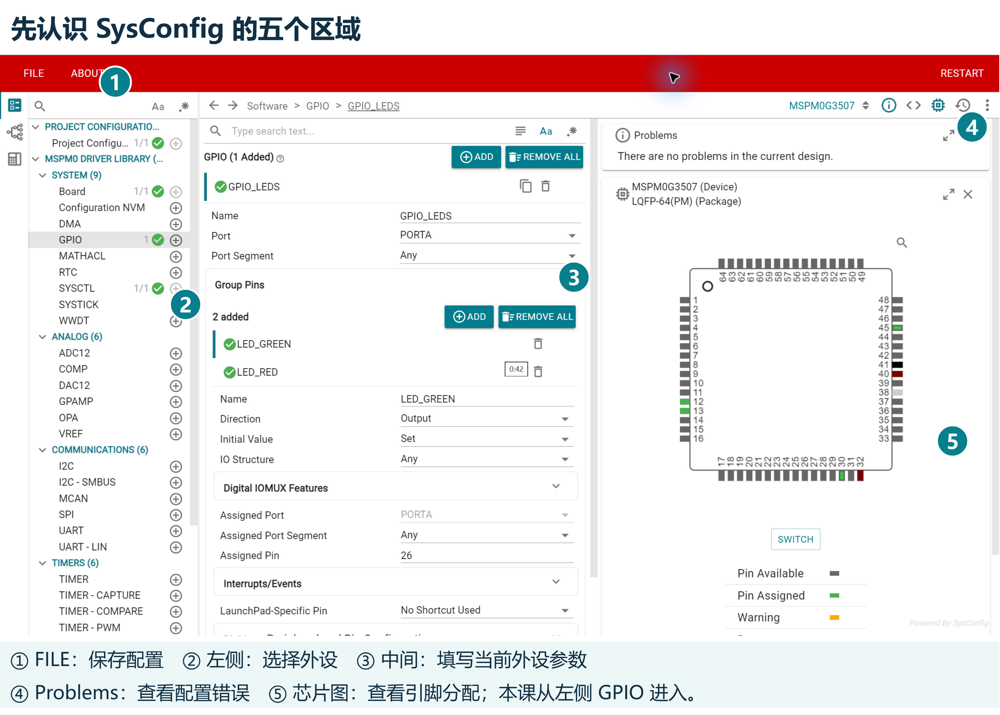

| 图中编号 | 区域 | 本课用法 |
| :--- | :--- | :--- |
| **① FILE 文件菜单** | 左上角红色菜单栏 | 修改完成后选择 `Save`，保存当前 `.syscfg` |
| **② 外设导航** | 最左侧的列表 | 展开 `MSPM0 DRIVER LIBRARY → SYSTEM`，点击 `GPIO`；以后学习 UART、定时器也从这里进入 |
| **③ 参数配置区** | 窗口中间；上方路径显示当前选中的外设与引脚 | 在现有 `GPIO_LEDS` 组内新增引脚，填写名称、方向、初始电平和引脚号 |
| **④ Problems** | 右上方 | 查看配置错误；本课保存前应显示 `There are no problems in the current design.` |
| **⑤ 芯片引脚图** | 右侧 | 查看芯片封装与引脚分配。图上的封装脚号与 `PA6` 的端口编号不是同一套编号，不要把芯片图的第 6 脚当成 PA6 |

左侧 GPIO 一行旁边的 **+** 用于新增外设实例；本课已有 `GPIO_LEDS`，应点击 **GPIO 文字进入现有配置**。中间也有两个 ADD，下一章会专门区分。找不到字段时在**中间配置区**向下滚动，左侧导航和右侧芯片图的位置不需要改变。

---

## 第三次实验：在真实 SysConfig 界面新增蓝色灯 {#second-led}

现在我们要迎接真正的挑战：**在 SysConfig 图形界面中新增一路蓝色 LED（PA6）配置，并在 `main.c` 中控制它闪烁！**

下面的操作图都从最大化的真实窗口重新采集；步骤图保留左侧导航和中间配置区，橙色图框标出当前要检查的控件。先看整窗总览定位区域，再按步骤操作。

---

### 第 1 步：打开当前工程，找到 GPIO_LEDS {#open-config}

1. 在 Studio 工作台左上角、工程文件树旁点击 **【SysConfig】** 按钮（宽布局也可能显示“配置芯片 · SysConfig”）；
2. 稍候片刻，SysConfig 图形化配置窗口会加载并显示到屏幕前台；
3. 在左侧外设列表中，依次展开：**MSPM0 DRIVER LIBRARY → SYSTEM → GPIO**，点击进入现有的 **GPIO_LEDS** 分组；
4. 你会看到：该组的端口（Port）已选定为 **PORTA**，并且在 **Group Pins** 下已经配置好了 `LED_GREEN` 和 `LED_RED` 两路引脚。

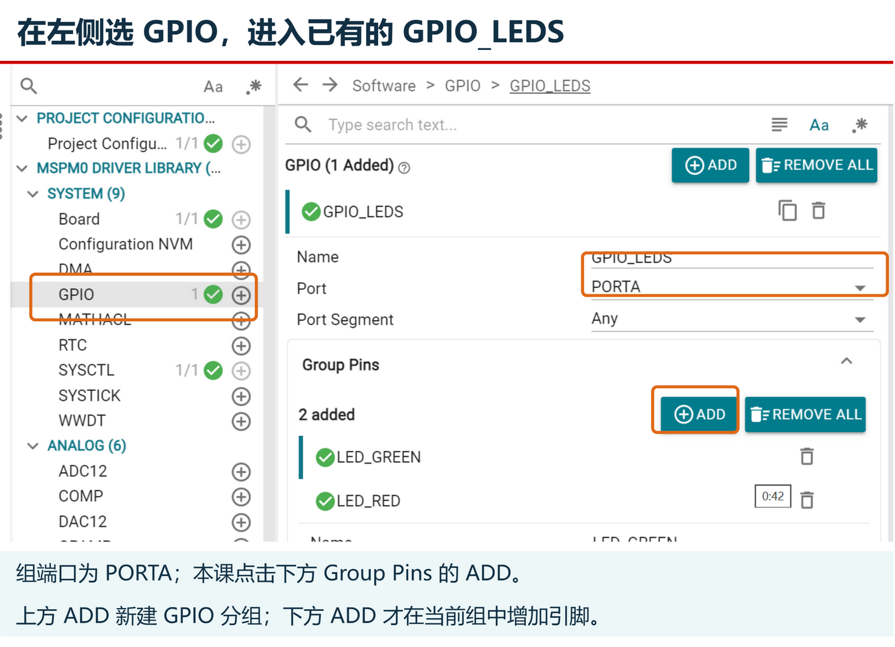

:::tip[认准 Group Pins 内的 ADD 按钮]
界面上有两个 `ADD` 按钮：上方用于新建一个全新的 GPIO 分组，**本课我们要点击的是下方 Group Pins 列表右侧的 ADD 按钮**，在现有的 LED 组内增加一路引脚。
:::

---

### 第 2 步：添加引脚并命名为 LED_BLUE {#add-blue}

1. 点击 **Group Pins** 右侧的 **ADD** 按钮；
2. 此时引脚数量提示会从 `2 added` 变为 **`3 added`**，列表下方新增了一个名为 `PIN_0` 的默认引脚；
3. 展开这个新引脚的配置卡片，将 **Name** 字段修改为 **`LED_BLUE`**（英文字母全部大写，带下划线）；
4. 确认 **Direction**（引脚方向）保持为 **Output**（输出模式，因为我们需要单片机向外输出电平来控制灯）。

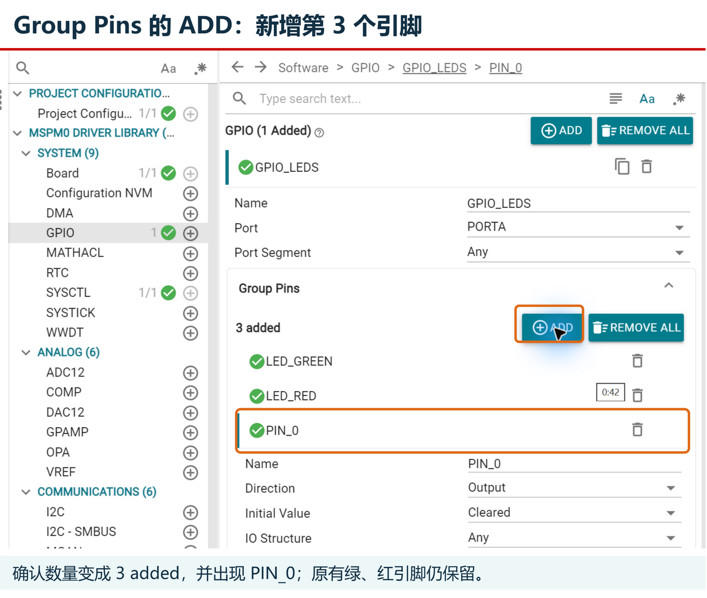

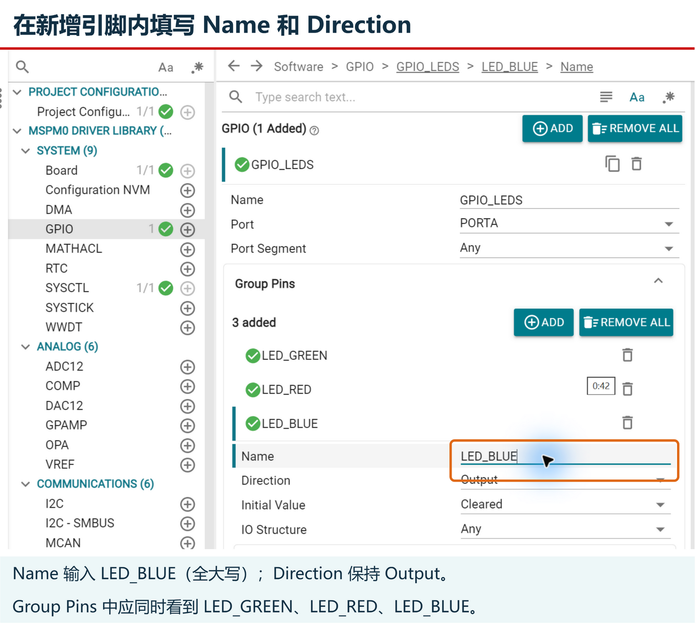

:::pitfall[新增蓝色通道，不要误改绿色通道]
请确保原有的 `LED_GREEN`（PA26）完好无损。我们是在组内新增第 3 个引脚，绝不能把原来的绿色引脚直接改名或删除！
:::

---

### 第 3 步：设置初始电平并绑定 PA6 {#bind-blue-pin}

#### 揭秘硬件电路：为什么初始电平要设为 Set？
让我们看一下开发板上关于 LED 的真实硬件电路结构：

```text
[3.3V 电源供电]
      │
   [限流电阻]
      │
   [LED 阳极 +]  (发光二极管正极)
   [LED 阴极 -]  (发光二极管负极)
      │
[MSPM0 PA6 引脚]
```

物理电路告诉我们：**只有当 LED 两端存在电压差时，电流才会流动，发光二极管才会点亮**。
- **当单片机引脚输出高电平（3.3V）时**：LED 两端都是 3.3V，电压差为 0V，没有电流流过，**LED 保持熄灭**；
- **当单片机引脚输出低电平（0V）时**：LED 阳极是 3.3V，阴极被拉低到 0V，两端形成 3.3V 压差，电流流过，**LED 点亮**！

这就是为什么这块板子是**低电平点亮**！为了避免程序刚通电时蓝灯就刺眼地常亮，我们在 SysConfig 中把 **Initial Value（初始电平）** 从默认的 `Cleared`（低电平）修改为 **`Set`（高电平）**，让蓝色灯在开机时先保持熄灭状态。

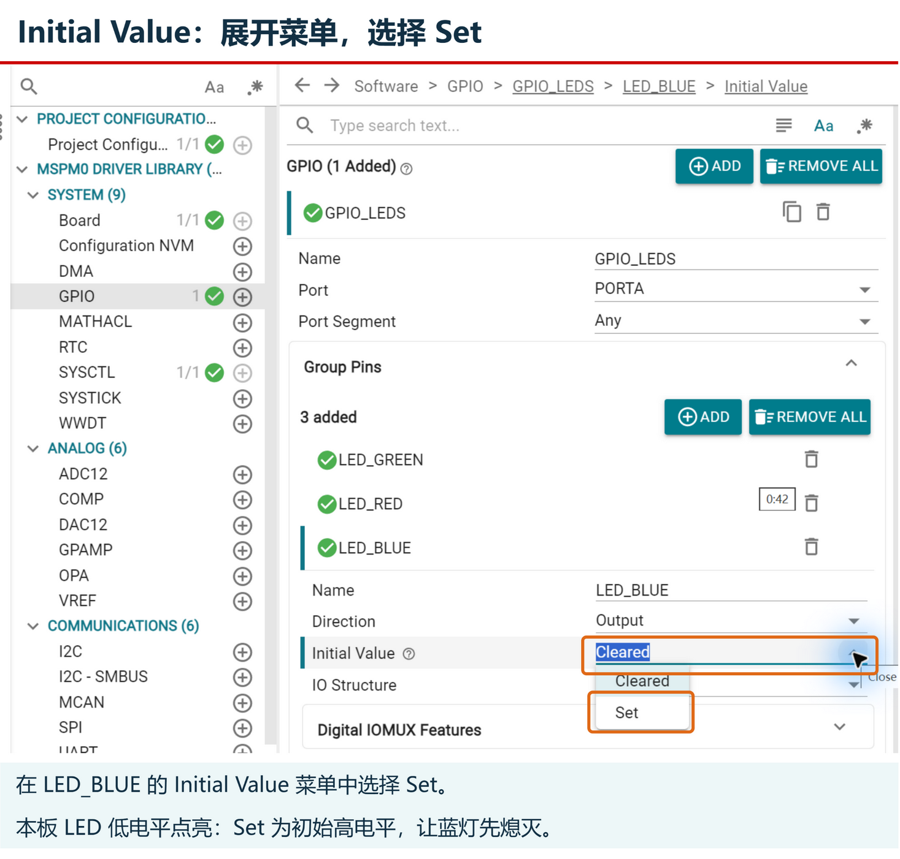

#### 绑定物理引脚 PA6
继续向下滚动，找到 **Assigned Pin**（分配引脚）选项：
- 将默认的 `Any` 改为数字 **`6`**。
- 因为整个 `GPIO_LEDS` 组已经绑定了 `PORTA`，这里的 6 就精准对应到了主控芯片的 **PA6** 引脚！其余选项（如 Assigned Port Segment）保持 `Any` 即可。

**完整配置核对清单：**

| 字段名称 | 设定值 | 作用与含义 |
| :--- | :--- | :--- |
| **Name** | `LED_BLUE` | 引脚别名，SysConfig 据此生成宏 `GPIO_LEDS_LED_BLUE_PIN` |
| **Direction** | `Output` | 输出模式，用于驱动外设 |
| **Initial Value** | `Set` | 初始输出高电平（3.3V），保持低电平点亮的 LED 初始熄灭 |
| **Assigned Port** | `PORTA` | 从所属组自动继承 |
| **Assigned Pin** | `6` | 物理管脚 PA6，连接开发板蓝色 LED 通道 |

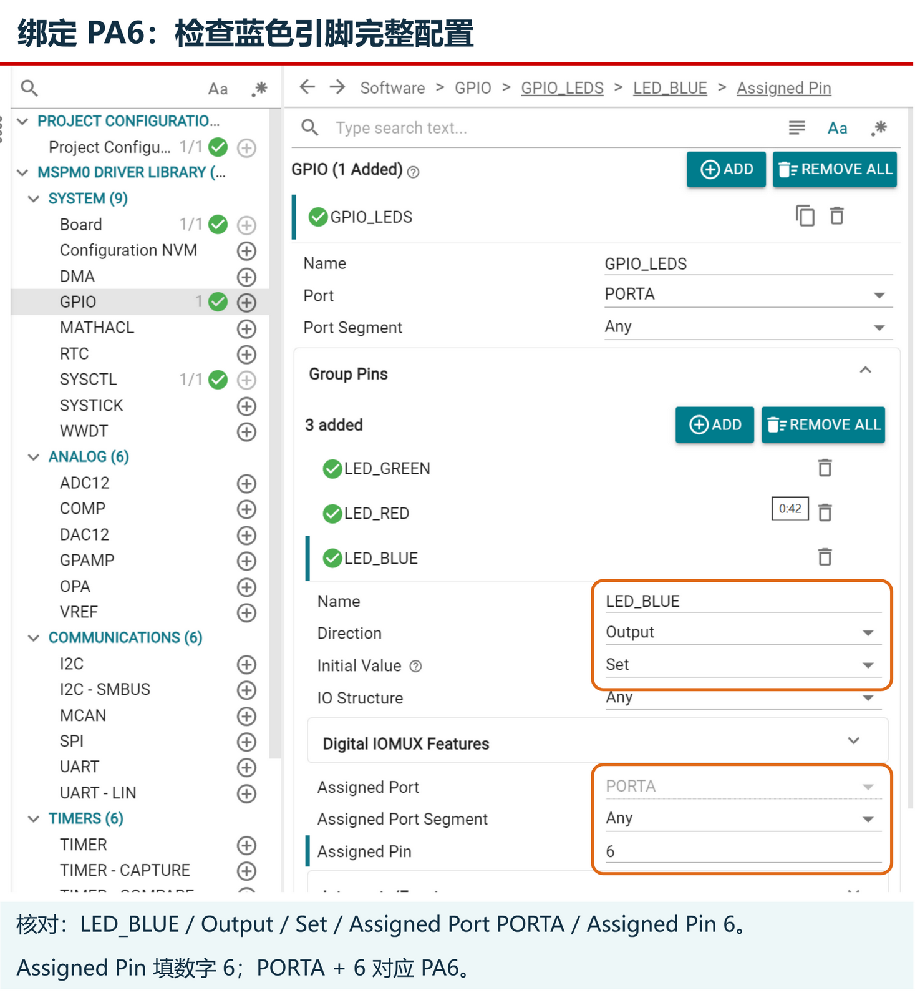

---

### 第 4 步：保存配置并返回 Studio {#save-config}

1. 在 SysConfig 窗口左上角点击菜单 **FILE → Save**（或者直接按下键盘快捷键 **`Ctrl + S`**）；
2. 观察窗口标题栏末尾的星号 `*` 是否消失，右上方的 **Problems** 是否显示 `There are no problems in the current design.`；
3. 确认保存成功后，最小化或关闭 SysConfig 窗口，返回 Studio 主工作台。

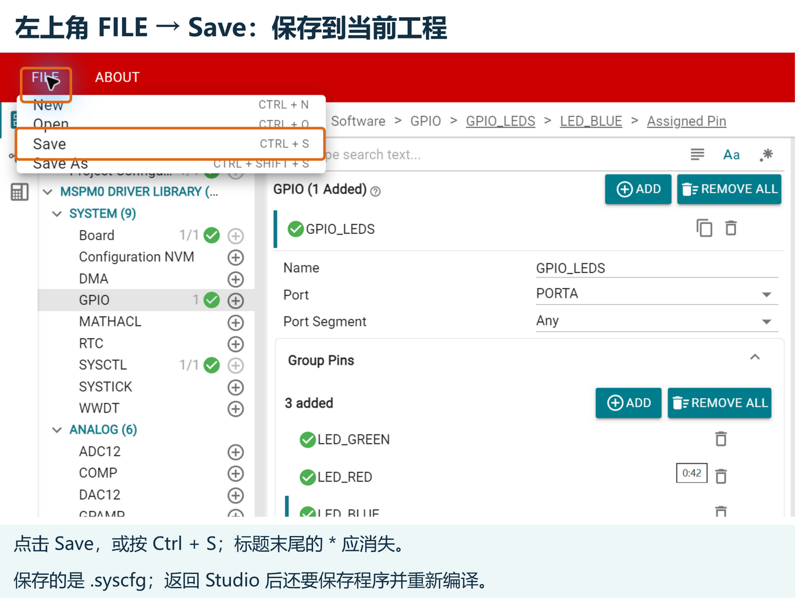

:::note[保存的到底是什么？]
点击 SysConfig 中的 Save，是把你的图形化点选保存回工程中的 `gpio_toggle_output.syscfg` 文件。它不会直接烧录硬件。下一次在 Studio 中点击编译时，系统就会读取该文件并自动生成最新的驱动代码！
:::

::task-link[前往任务：新增蓝色灯配置]{step="open-sysconfig"}

---

### 第 5 步：修改代码控制目标，重新编译烧录 {#run-blue}

配置完成后，我们只需要在 `src/main.c` 中把控制目标由绿灯切换为蓝灯：

::code-target[定位需要修改的灯通道]{path="src/main.c" line="14"}

```c
/* 修改前：翻转控制绿色通道 */
DL_GPIO_togglePins(GPIO_LEDS_PORT, GPIO_LEDS_LED_GREEN_PIN);

/* 修改后：翻转控制蓝色通道 */
DL_GPIO_togglePins(GPIO_LEDS_PORT, GPIO_LEDS_LED_BLUE_PIN);
```

请保留延时参数 `blink_interval_ms = 1000U;`，并保存代码（`Ctrl + S`）。

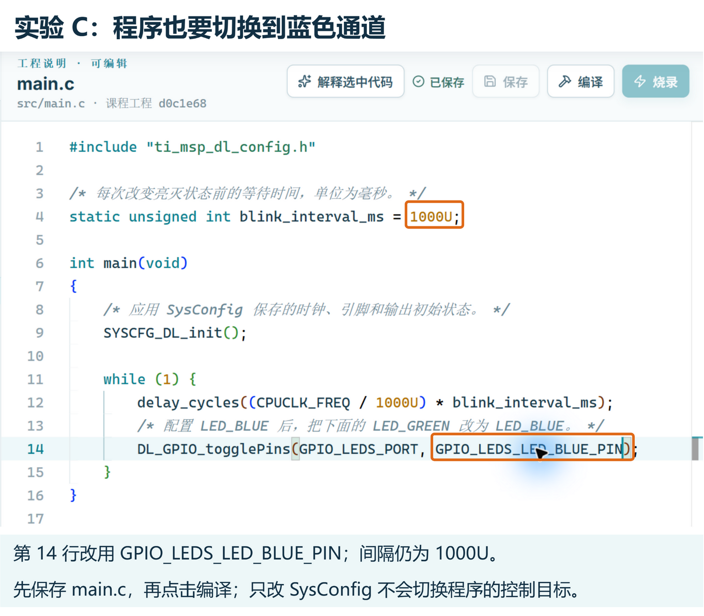

保存后确认编辑器显示 **“已保存”**；若仍显示“有未保存修改”，点击编辑器右上方的 **【保存】** 按钮，看到状态变化后再编译。

接下来见证奇迹：
1. 点击 Studio 的 **【编译】** 按钮。在终端日志中，你会看到系统自动唤起 SysConfig 根据刚保存的配置生成了包含 `GPIO_LEDS_LED_BLUE_PIN` 的头文件，紧接着 GCC 编译器完成了整个固件的构建！
2. 编译成功后，点击 **【烧录】** 按钮（或任务栏的【写入开发板】），将固件刷入芯片并等待复位；
3. 观察开发板上的 RGB LED：原先闪烁的**绿色灯保持熄灭**，而**蓝色灯开始以约 1 秒亮、1 秒灭的平缓节奏交替闪烁**！
4. 在任务栏最后一步中记录实际看到的现象，恭喜你完整掌握了单片机的图形化配置与开发工作流！

::task-link[修改应用控制目标]{step="edit-application"}

::task-link[生成并编译蓝色灯程序]{step="firmware-build"}

::task-link[记录蓝色灯的实物现象]{step="observe-led"}

---

## 常见问题排查、课后思考与小结 {#troubleshooting-and-summary}

### 新手常见问题排查清单 {#troubleshooting}

在工程实践中，遇到问题是极其正常的事情。如果实验现象与预期不一致，请对照以下清单冷静排查：

| 现象 / 遇到的问题 | 原因分析与排查方案 |
| :--- | :--- |
| **点击【配置芯片 · SysConfig】没有反应？** | 检查窗口是否已被最小化或被其他应用遮挡；再次点击按钮可将现有窗口唤回前台。 |
| **Studio 顶部的【编译】按钮是灰色的？** | 代码编辑器中还有未保存的修改，请按 `Ctrl + S` 保存文件；或当前有编译/烧录任务正在后台运行，等待其结束即可。 |
| **编译报错提示 `GPIO_LEDS_LED_BLUE_PIN` 未定义？** | ① 检查 SysConfig 中的 Name 是否准确拼写为 `LED_BLUE`；② 检查在 SysConfig 中是否点击了 `FILE → Save` 保存文件；③ 重新点击编译。 |
| **SysConfig 界面出现红叉提示引脚冲突？** | 检查 `Assigned Pin` 是否正确填为 `6`；检查是否不小心添加了其他无关的外设或误改了原有引脚。 |
| **在 SysConfig 中点击 ADD 后出现了另一个 GPIO 组？** | 你误点了上方的 ADD（新建分组）；请点击下方 `Group Pins` 列表内的 ADD（在现有组内增加引脚）。 |
| **烧录时提示找不到芯片或下载器？** | 检查 Type-C 数据线是否连接稳固；仔细对照 SWD 引脚丝印，检查 3.3V、GND、SWDIO、SWCLK 接线是否牢靠，确认板上电源指示灯常亮。 |
| **烧录成功但开发板上的灯毫无变化？** | ① 检查是否保存并重新编译；代码或 SysConfig 配置变化后，Studio 会拒绝使用旧编译产物；② 检查 `main.c` 中是否将绿灯宏成功改为了蓝灯宏。 |

:::tip[工程调试黄金法则：单变量控制原则]
软硬件联调时切忌一次性乱改多处代码。**每次只修改一个变量**（例如先单独改延时数字，再单独改配置和控制通道），才能精准确认每一次修改与硬件反馈之间的因果关系。
:::

---

### 课后思考：理清软硬件闭环 {#reflection}

请先停下来想一想，再在实验任务栏中写下你的回答：

1. **单片机芯片、开发板底板与电脑上的 Studio 分别扮演什么角色？**
2. **在 SysConfig 中配置并保存了蓝色引脚后，为什么还必须修改 `main.c` 并重新编译烧录，蓝灯才会闪烁？**
3. **“保存”、“编译”、“烧录”和“实板观察”这四个步骤，分别证明了哪一件事成功完成？**
4. **为什么延时参数设定为 1000 ms 时，开发板上 LED 完整亮灭一轮的时间大约是 2 秒？**

::task-link[完成课后思考题]{step="reflect-workflow"}

---

### 本课小结 {#summary}

恭喜你完成了单片机开发的第一课！今天你不仅迈过了从“软件纯文本”到“硬件真实动作”的心理门槛，更掌握了现代嵌入式工程师必备的核心工作流：

1. **认识了单片机本源**：理解了 MCU 是一颗集成了 CPU、存储器与引脚控制的微型计算机，建立了“输入—处理—输出”的系统思维；
2. **掌握了工程四步闭环**：建立了“保存代码 → 编译固件 → 烧录芯片 → 观察硬件”的严谨工程方法，学会了单变量控制与排错；
3. **彻底掌握了 SysConfig 利器**：理解了硬件配置（`.syscfg`）与业务逻辑（`main.c`）分工协作的先进软件架构，学会了在图形界面中配置 GPIO 并自动生成底层驱动代码。

在接下来的课程中，无论是学习按键检测、串口通信、定时器中断，还是未来驱动机器马稳健行走，我们都将反复运用今天掌握的这套开发闭环：**在 SysConfig 中点选硬件外设 → 自动生成驱动 → 在 main.c 中挥洒算法逻辑！**
